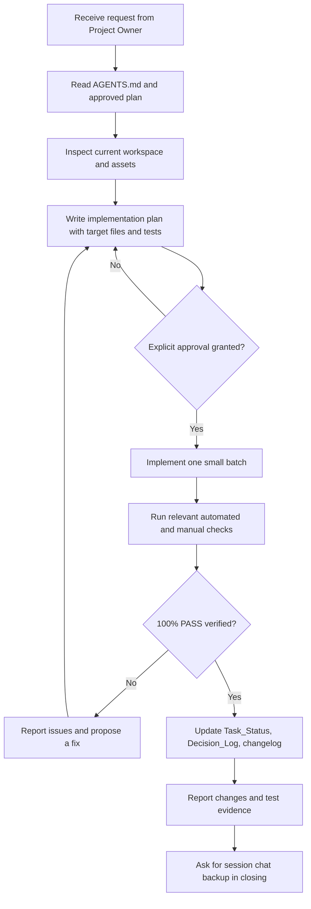

# GEMINI.md — AI Agent Work Rules for CamHub (Camera Marketplace Platform)

> **Purpose:** This file is a concise index of the mandatory working rules for Gemini and other AI coding agents working on **CamHub (Camera Marketplace Platform)**.
>
> **Project owner:** Yogi Ario.
> **Core rule:** *No Plan, No Code. No Approval, No Code. No Evidence, No Completion.*

Before performing project work, read the root [`AGENTS.md`](../../AGENTS.md) (or [`Docs/aturan/AGENTS.md`](./AGENTS.md)), [`Docs/aturan/universal-rule.md`](./universal-rule.md), and the approved project implementation plan [`Docs/implementation_plan.md`](../implementation_plan.md). If any referenced document is missing, do not invent its contents; ask Yogi Ario or locate the explicitly approved plan first.

## Mandatory Rules

1. **Implementation Plan and approval gate**
   For every new feature, bug fix, structural change, or configuration change, inspect the current project and prepare a written implementation plan first. Include the goal, scope, options/trade-offs where relevant, target files, risks, test plan, and acceptance criteria. Wait for Yogi Ario's explicit approval before editing code or project configuration. An instruction to inspect, analyze, or plan is not permission to implement.

2. **Project identity and technology**
   - Project: **CamHub**, web-based camera marketplace platform providing 4 core services: camera rentals, sales & purchases, consignments (titip jual), and partner store management in Indonesia.
   - Framework / Engine: PHP Native (Modular MVC-inspired) with PDO database access running on Laragon (Apache/Nginx, MySQL, PHP 8.x). Third-party backend frameworks (Laravel, CodeIgniter, etc.) are strictly prohibited without explicit owner approval.
   - Language: PHP Native (PDO), HTML5, CSS3, JavaScript.
   - Target: Web Desktop & Mobile Responsive, Indonesian Market.
   - Player/User-facing UI language: Bahasa Indonesia.
   - MVP Mode: Client-Server Web Application (Modular PHP Native with PDO, Session Management, and MySQL Database).
   - Core constraints:
     - Strict adherence to the 9 UI/UX prototype reference designs in `template/CamHub - Interactive UI UX Prototype/`. Do not alter layout, colors, or replace components with generic templates.
     - Security: PDO Prepared Statements, secure password hashing (`password_hash`/`password_verify`), CSRF tokens on mutating requests, XSS sanitization, role-based authorization (Customer, Partner, Administrator), and protected KYC document handling.
     - Business logic: Prevent overlapping rental schedules at both database level (transactions/locking) and service logic level. Escrow and payments must comply with proper transaction logging and audit trails.

3. **Project safety and configuration protection**
   Do not upgrade/downgrade runtime versions, modify package manifests, or perform destructive operations without explicit approval. Do not delete, rename, move, overwrite, or mass-edit source files, assets, or environment configurations without documenting the impact and receiving approval.

4. **Architectural discipline; no unapproved services**
   Adhere to the approved architecture: **Modular PHP Native (Separation of Concerns: Presentation Layer, Controller Layer, Service Layer, Repository Layer, Database Layer)**. Do not add unauthorized third-party SDKs, databases, cloud integrations, analytics, or external APIs without an explicitly approved proposal. For modular components, follow scoped rules in `Docs/aturan/AGENTS.md` without overriding root governance.

5. **UI and asset integrity**
   Treat original UI mockups and prototypes in `template/CamHub - Interactive UI UX Prototype/` and `Docs/mockups/` as strictly read-only. Never overwrite or remove source assets. Implement visual templates cleanly into `resources/views/` and `public/assets/`.

6. **Core domain decisions that must remain consistent**
   - Main flow:
     - Rental: Select Camera & Dates -> Availability Check -> Booking & Checkout -> Payment/Escrow -> Rental Period -> Return & Funds Release.
     - Sales & Purchases: Product Catalog -> Cart -> Checkout -> Payment -> Shipping -> Order Received Confirmation.
     - Consignment (Titip Jual): Consignment Submission -> Partner Inspection/Approval -> Commission Determination -> Product Listed -> Sales -> Revenue Distribution.
     - Identity & Access: User Registration -> Login (Role-based redirect) -> Profile & KYC Submission -> Admin KYC Verification.
   - Validation & Business Logic:
     - Strict schedule overlap prevention for rental units.
     - Accurate stock management for direct product sales.
     - Clear fee/commission breakdown for consignments.
     - Server-side validation for KYC document types, file sizes, and MIME types.
     - CSRF verification on all form submissions.
   - Do not alter these foundational decisions silently. Propose changes and wait for approval.

7. **Documentation-first workflow**
   Keep project documentation current: `Docs/Task_Status.md`, `Docs/Decision_Log.md`, `Docs/implementation_plan.md`, `Docs/Test_Report.md`, and a timestamped flat changelog directly under `changelog/` (`changelog/changelog<jam><ampm><ddmmyyyy>.md`, e.g., `changelog/changelog03am01102026.md`, strictly no subfolders). If a required document or directory does not exist, propose its creation in the plan first. Do not report documentation as updated unless it actually was.

8. **Testing and honest reporting**
   Execute automated test suites where appropriate (`tests/Unit/`, `tests/Integration/`), plus relevant manual checks (`tests/Manual/`). Inspect runtime logs/console errors and warnings related to the change. Never claim “100% PASS” or a verified feature unless the corresponding test was actually run and its result observed. If a test cannot run, state why and list the remaining manual verification.

9. **Git and release safety**
   Inspect the repository and current branch before Git operations. Do not commit or push directly to `main`; the owner controls merges to `main`. Use `develop` as the integration branch and follow the 13 implementation stages on feature branches (`tahap/<nomor>-<nama-tahap>` branched from `develop`).

10. **Communication and session backup**
    Work in small, reviewable batches. Use formal and clear Bahasa Indonesia as mandated by Implementation Plan BAB 11. Explain proposed changes and wait for approval when required. At the end of each response, ask Yogi Ario whether to save a Markdown chat summary under `Docs/chat/riwayat<ddmmyyyy>.md`.

## Standard Task Workflow

## Important Project Files

- [`Docs/aturan/universal-rule.md`](./universal-rule.md) / [`AGENTS.md`](../../AGENTS.md) — master universal governance framework.
- [`Docs/implementation_plan.md`](../implementation_plan.md) — approved implementation plan (13 Tahap).
- [`Docs/Task_Status.md`](../Task_Status.md) — work progress tracking.
- [`Docs/Decision_Log.md`](../Decision_Log.md) — approved project decisions.
- [`Docs/Test_Report.md`](../Test_Report.md) — verification evidence.
- Source directories: `app/`, `public/`, `resources/views/`, `config/`, `database/`, `routes/`.
- `tests/` — automated and manual test suites (`Unit/`, `Integration/`, `Manual/`).

> **Final rule:** Do not make code or project configuration changes until the written plan has been explicitly approved by Yogi Ario. Never claim that a feature works without observed verification.
