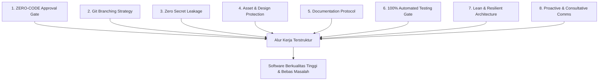
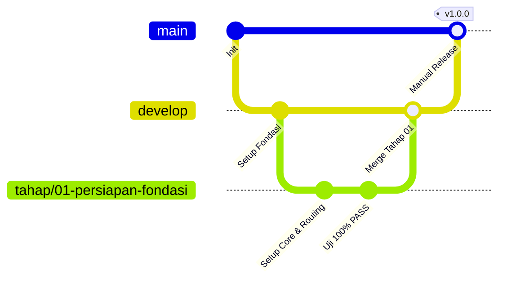

# UNIVERSAL-RULE.md — Kerangka Standar Kerja Pengembangan Proyek & AI Agent

> **STATUS:** DOKUMEN STANDAR UNIVERSAL (MASTER FRAMEWORK) — KHUSUS PROYEK CAMHUB
> **OTORITAS TERTINGGI:** Yogi Ario (PROJECT OWNER / LEAD DEVELOPER)
> **TARGET PENGGUNA:** Seluruh Pengembang (Human Developer) & AI Agent (Antigravity, Gemini, Claude, Cursor, dll.)
> **REUSABILITAS:** Wajib dipatuhi pada repositori CamHub yang dikelola oleh: Yogi Ario.

---

## 📖 Pendahuluan & Filosofi Kerja

Dokumen ini adalah **pedoman tata kelola universal (Universal Governance Framework)** yang dirancang untuk menjaga kualitas, keamanan, transparansi, dan kerapian pengerjaan software engineering dari awal hingga rilis produksi platform **CamHub (Camera Marketplace Platform)**.

### 🧭 Core Philosophy: Consistent Standards, Variable Intelligence

> **"AI may vary in intelligence. Project standards must remain consistent."**

Kualitas penalaran, kemampuan mempertahankan konteks, dan keandalan eksekusi setiap AI Agent dapat berbeda-beda. Karena itu, proses pengembangan tidak boleh bergantung pada asumsi bahwa AI Agent akan selalu memahami instruksi atau menghasilkan pekerjaan dengan kualitas yang sama. **Standar kerja, gerbang persetujuan, dokumentasi, dan bukti pengujian harus tetap konsisten**, siapa pun AI Agent atau pengembang yang mengerjakannya.

Prinsip operasional yang menjadi dasar kerangka ini:

- **No Plan, No Code.** Rencana tertulis harus tersedia sebelum perubahan dilakukan.
- **No Approval, No Code.** Perubahan yang memerlukan persetujuan tidak boleh dijalankan sebelum persetujuan eksplisit diberikan oleh Yogi Ario.
- **No Evidence, No Completion.** Pekerjaan tidak boleh dinyatakan selesai tanpa bukti verifikasi yang sesuai (100% PASS, audit log, commit hash, screenshot).
- **No Superfluous AI Boilerplate:** Jangan menambahkan elemen formalitas tambahan, blok komentar yang tidak perlu, atau *boilerplate* artifisial yang tidak ada pada panduan penugasan agar tetap natural, otentik, dan tidak tampak seperti hasil generasi instan AI.

Setiap AI Agent atau pengembang yang memulai sesi pada repositori CamHub **WAJIB membaca, memahami, dan mematuhi 8 Pilar Standar Kerja** berikut tanpa terkecuali.

---

## 🏛 Delapan Pilar Standar Kerja Universal



---

### 🛑 Pilar 1: ZERO-CODE Sebelum Persetujuan Rencana (Approval Gate)

**Prinsip Inti:** *No Plan, No Code. No Approval, No Code. No Evidence, No Completion.*

1. **Dilarang Keras Menyentuh Kode Terlebih Dahulu:**
   - Jangan pernah membuat, mengedit, atau menghapus file kode aplikasi sebelum menyusun rencana kerja tertulis dan memperoleh **persetujuan eksplisit** dari Yogi Ario.
2. **Format Wajib Implementation Plan:**
   Setiap kali ada instruksi, tahap baru, fitur baru, atau perbaikan bug, buatlah dokumen rencana (*Implementation Plan*) yang memuat:
   - **Tujuan & Ruang Lingkup:** Apa yang ingin dicapai sesuai `Docs/implementation_plan.md`.
   - **Analisis & Pilihan Solusi:** Tawarkan opsi jika ada trade-off teknis (misal Opsi A vs Opsi B).
   - **Daftar File Target:** File mana yang akan dibuat, dimodifikasi, atau diuji.
   - **Alur Pengujian:** Bagaimana cara membuktikan bahwa fitur bekerja dan bebas regresi.
3. **Gerbang Persetujuan (Approval Gate):**
   - AI Agent wajib berhenti dan menunggu konfirmasi Yogi Ario (misal: pesan "Oke disetujui", "Lanjut", atau respon positif serupa) sebelum menyentuh kode.

---

### 🌿 Pilar 2: Protokol Branching Git & Kontrol Rilis

**Prinsip Inti:** *Branch `main` adalah Mahkota Produksi — Hanya Yogi Ario yang Boleh Me-Merge.*



1. **Branch `main` (Produksi Tertutup):**
   - Berisi kode stabil rilis produksi.
   - **DILARANG KERAS** melakukan commit atau push langsung ke `main` oleh AI Agent atau developer.
   - Merge dari `develop` ke `main` dilakukan **secara manual oleh Yogi Ario**.
2. **Branch `develop` (Branch Integrasi Utama):**
   - Seluruh pembaruan, perbaikan, dan fitur baru yang telah lulus uji wajib digabungkan ke `develop` dan di-push ke `origin develop`.
3. **Branch Tahap / Fitur (`tahap/<nomor>-<nama-tahap>` / `fix/<nama-bug>`):**
   - Setiap tahapan pengerjaan mengacu pada 13 tahapan resmi di `Docs/implementation_plan.md` (misal: `tahap/01-persiapan-fondasi`, `tahap/02-perancangan-database`, dst.) yang dicabangkan langsung dari `develop`.
   - Setiap perubahan dicatat melalui commit yang jelas dan tidak dimanipulasi.
   - Setelah pekerjaan selesai dan lulus uji 100%, branch tahap digabungkan (*merge*) kembali ke `develop` melalui persetujuan review.

---

### 🔐 Pilar 3: Keamanan Kunci Rahasia & Tata Kelola `.env` (Zero Secret Leakage)

**Prinsip Inti:** *Kunci API dan Kredensial Pribadi adalah Aset Paling Sensitif.*

1. **Perlindungan `.gitignore` Sejak Menit Pertama:**
   - File konfigurasi rahasia (`.env`, `.env.local`), file kunci lokal (`Docs/api`, `secrets.json`, file service account), log, file upload runtime (`storage/uploads/`), dan database lokal **wajib langsung dimasukkan ke `.gitignore`** sebelum commit perdana.
2. **Larangan Kebocoran Kunci:**
   - Jangan pernah menuliskan nilai kredensial database, kunci payment gateway, atau token rahasia ke dalam prompt obrolan publik, commit message, atau file kode yang ditrack oleh Git.
3. **Template Konfigurasi Bersih (`.env.example`):**
   - Selalu sediakan dan perbarui file `.env.example` berisi nama variabel tanpa nilai rahasia (gunakan dummy placeholder seperti `DB_PASS=secret_password`).

---

### 🎨 Pilar 4: Proteksi Integritas Aset & Desain (`template/` / Raw Assets)

**Prinsip Inti:** *Aset Asli Tim UI/UX adalah Bahan Rujukan Murni (Read-Only).*

1. **Status READ-ONLY untuk Folder Desain:**
   - Folder prototipe mentah (`template/CamHub - Interactive UI UX Prototype/` atau `Docs/mockups/`) yang disediakan desainer dilarang keras diubah, ditimpa, atau dihapus oleh AI Agent / Backend Developer.
   - 9 Halaman acuan utama: Beranda, Katalog Produk, Detail Produk, Booking & Checkout, Dashboard Pelanggan, Login & Register, Dashboard Mitra Lapak, Dashboard Admin, Verifikasi Identitas KYC.
   - Dilarang mengubah struktur layout, warna, ukuran/posisi komponen, atau mengganti desain dengan template generik.
2. **Pola Adopsi Bersih:**
   - Desain antarmuka diadopsi/dibuat secara terstruktur ke folder views/components produksi (`resources/views/` dan `public/assets/`), lalu dihubungkan dengan business logic dinamis.

---

### 📝 Pilar 5: Protokol Dokumentasi Wajib (Documentation-First)

**Prinsip Inti:** *Kode Tanpa Dokumentasi adalah Utang Teknis di Masa Depan.*

Setiap pengerjaan pada proyek CamHub wajib memelihara folder `Docs/` dan folder `changelog/` yang selalu diperbarui:

| Nama Berkas                   | Lokasi                                        | Fungsi & Aturan Pembaruan                                                                                                                                                                                                                                                                                                                                      |
| ------------------------------- | ----------------------------------------------- | ---------------------------------------------------------------------------------------------------------------------------------------------------------------------------------------------------------------------------------------------------------------------------------------------------------------------------------------------------------------- |
| **`Task_Status.md`**          | `Docs/Task_Status.md`                         | Melacak status 13 tahapan proyek CamHub, persentase progres, dan checklist tugas real-time.                                                                                                                                                                                                                                                                     |
| **`Decision_Log.md`**         | `Docs/Decision_Log.md`                        | Mencatat seluruh keputusan teknis/arsitektur (ID, Tanggal, Topik, Keputusan, Rationale, Status Persetujuan Yogi Ario).                                                                                                                                                                                                                                          |
| **`implementation_plan.md`**  | `Docs/implementation_plan.md`                 | Rencana induk teknis implementasi backend CamHub (13 Tahap & arsitektur modular).                                                                                                                                                                                                                                                                                |
| **`Test_Report.md`**          | `Docs/Test_Report.md`                         | Laporan hasil verifikasi pengujian otomatis dan manual (100% PASS).                                                                                                                                                                                                                                                                                             |
| **Changelog Bertimestamp**    | `changelog/changelog<jam><ampm><ddmmyyyy>.md` | Catatan perubahan bertimestamp waktu lokal per batch rilis atau tahapan selesai. **Wajib flat** (disimpan langsung di dalam folder `changelog/`, dilarang membuat subfolder). Format: 2 digit jam (`03am` / `02pm`, huruf am/pm kecil) dan 8 digit tanggal (`ddmmyyyy`). Contoh: `changelog/changelog03am01102026.md` atau `changelog/changelog02pm31102026.md`. |
| **Cadangan Riwayat Chat**     | `Docs/chat/riwayat<ddmmyyyy>.md`              | Arsip komprehensif riwayat dialog interaktif antara Yogi Ario dan AI Agent dari awal hingga akhir sesi.                                                                                                                                                                                                                                                         |

---

### 🧪 Pilar 6: Gerbang Verifikasi Pengujian (100% Automated Testing Gate)

**Prinsip Inti:** *Jangan Pernah Bilang Selesai Jika Belum Terbukti Lulus Uji.*

1. **Wajib Memiliki Test Suite Terstruktur:**
   - Proyek wajib memiliki skrip verifikasi mandiri (Unit, Integration, dan skenario Manual) di folder `tests/` (`tests/Unit/`, `tests/Integration/`, `tests/Manual/`).
2. **Definisi Selesai (Definition of Done - DoD):**
   - Suatu tahap hanya boleh dilaporkan selesai jika test suite telah dijalankan di terminal Laragon/PowerShell dan menghasilkan:
     **`HASIL: 100% PASS (0 GAGAL / 0 ERROR)`**.
3. **Pencegahan Regresi:**
   - Setiap penambahan fitur baru wajib disertai penambahan kasus uji pada test suite. Dilarang mengarang bukti pengujian.

---

### ⚡ Pilar 7: Kedisiplinan Arsitektur & Provider (Lean & Resilient)

**Prinsip Inti:** *Sederhana, Cepat, Andal, dan Tanpa Ketergantungan Berlebihan.*

1. **Teknologi Baku (Strict Native Policy):**
   - Menggunakan **PHP Native (PDO)**, **MySQL**, dan **Laragon**.
   - Dilarang mengganti atau menyisipkan framework full-stack (Laravel, CodeIgniter, Symfony, dll.) tanpa persetujuan eksplisit Yogi Ario.
2. **Kunci Provider Tunggal / Efisien (Anti-Bloat):**
   - Kunci 1 payment gateway provider terbaik (misal Midtrans/Xendit) sebagai single source of truth untuk transaksi pembayaran & escrow.
3. **Pemisahan Tanggung Jawab (Separation of Concerns):**
   - **Presentation Layer:** `resources/views/` & `public/assets/`
   - **Controller Layer:** `app/Controllers/`
   - **Service / Application Layer:** `app/Services/` (Business logic, rental scheduling, escrow calculation)
   - **Repository / Data Access Layer:** `app/Repositories/` (PDO prepared statements, transaction locking)
   - **Database Layer:** MySQL (`database/schema.sql`, `database/migrations/`)
   - **Middleware & Validators:** `app/Middleware/` & `app/Validators/`
4. **Hierarki Aturan Kode Sumber & Scoped AI Agent:**
   - **Root `Docs/aturan/universal-rule.md` & `AGENTS.md`:** Otoritas makro tata kelola proyek.
   - **Modul `AGENTS.md` (Scoped Rules):** Jika modul tertentu memiliki batasan teknis ketat, gunakan panduan modular dari `Docs/aturan/AGENTS.md`.
   - **Resolusi Konflik:** Jika aturan lokal modul bertentangan dengan aturan universal, **aturan universal root dan keputusan eksplisit Yogi Ario selalu menjadi otoritas tertinggi.**

---

### 🤝 Pilar 8: Standar Komunikasi & Konsultasi AI Agent

**Prinsip Inti:** *AI Agent adalah Rekan Berpikir (Pair Programmer) yang Ramah, Jelas, dan Edukatif.*

1. **Proaktif Memberikan Solusi Berbasis Opsi:**
   - Jika ada kebingungan atau percabangan teknis, sajikan pilihan (misal: *Opsi A: Cepat & Mandiri* vs *Opsi B: Integrasi Pihak Ketiga*) beserta kelebihan, kekurangan, dan rekomendasi ahli.
2. **Bahasa Resmi:**
   - Gunakan Bahasa Indonesia yang baku, profesional, jelas, dan ramah sesuai ketentuan Bab 11 Implementation Plan.
3. **Tautan Markdown yang Dapat Diklik:**
   - Selalu sertakan tautan berkas yang dapat diklik (`[file.ext](file:///path/to/file)`).
4. **Kewajiban Menanyakan Pencadangan Riwayat Chat di Akhir Respon:**
   - **Wajib di Setiap Akhir Respon:** Setiap kali selesai memberikan respon (baik merespons pertanyaan, menyajikan rencana, maupun menyelesaikan implementasi), AI Agent **WAJIB secara proaktif bertanya di penutup respon** kepada pengguna apakah ingin mencadangkan (*backup*) riwayat percakapan sesi tersebut.
   - **Pola Penamaan & Lokasi Berkas:** Berkas cadangan disimpan dalam format markdown pada subdirektori terstruktur `Docs/chat/` dengan pola:
     `Docs/chat/riwayat<ddmmyyyy>.md`
   - **Contoh Kalimat Penutup:**
     > *"Apakah Anda ingin saya mencadangkan riwayat percakapan sesi ini ke `Docs/chat/riwayat<ddmmyyyy>.md`?"*

---

## 📁 Struktur Direktori Standar Proyek CamHub

Struktur direktori proyek CamHub yang wajib dipedomani secara bertahap:

```text
camhub/
├── .gitignore                     # Perlindungan awal (.env, secrets, logs, uploads, cache)
├── .env.example                   # Template konfigurasi database & kredensial tanpa rahasia
├── README.md                      # Dokumentasi pengenalan, arsitektur, dan panduan Laragon
├── AGENTS.md                      # Indeks aturan kerja AI (merujuk ke Docs/aturan/universal-rule.md)
├── GEMINI.md                      # Indeks aturan kerja Gemini khusus proyek CamHub
│
├── app/                           # Kode sumber arsitektur Modular PHP Native
│   ├── Controllers/               # Penanganan HTTP request dan alur antarmuka
│   ├── Models/                    # Definisi entitas dan data mapping
│   ├── Repositories/              # Akses database MySQL via PDO prepared statements
│   ├── Services/                  # Logika bisnis utama (rental, order, consignment, escrow)
│   ├── Middleware/                # Auth, Role-based guard, CSRF protection
│   ├── Validators/                # Validasi input server-side
│   └── Helpers/                   # Utilitas & helper umum
│
├── config/                        # File konfigurasi sistem (database, app, payment)
│
├── database/                      # Skema, migrasi, dan seeder MySQL
│   ├── migrations/
│   ├── seeders/
│   └── schema.sql
│
├── public/                        # Web root / Entry point untuk Laragon
│   ├── index.php                  # Front controller / entry point utama
│   ├── .htaccess                  # URL rewriting
│   └── assets/                    # Aset statis (css, js, images, fonts)
│
├── resources/
│   └── views/                     # Template presentasi (layouts, components, pages)
│
├── routes/                        # Definisi rute web publik, customer, mitra, admin
│
├── storage/                       # Storage lokal untuk upload (KYC, produk), logs, cache
│   ├── logs/
│   ├── uploads/
│   └── cache/
│
├── tests/                         # Suite pengujian otomatis & manual (100% PASS Gate)
│   ├── Unit/
│   ├── Integration/
│   └── Manual/
│
├── Docs/                          # Seluruh dokumentasi formal proyek CamHub
│   ├── aturan/                    # Aturan tata kelola (universal-rule.md, GEMINI.md, AGENTS.md)
│   ├── implementation_plan.md     # Rencana induk implementasi backend (Tahap 01 - 13)
│   ├── Task_Status.md             # Pelacak progres fase dan checklist tugas
│   ├── Decision_Log.md            # Catatan riwayat keputusan teknis & arsitektur
│   ├── Test_Report.md             # Laporan hasil verifikasi pengujian
│   ├── mockups/                   # Dokumentasi visual prototype
│   └── chat/                      # Arsip berkala riwayat percakapan sesi AI
│       └── riwayat<ddmmyyyy>.md   # Berkas riwayat chat per tanggal
│
├── changelog/                     # [FLAT] Catatan perubahan bertimestamp (dilarang subfolder)
│   └── changelog<jam><ampm><ddmmyyyy>.md
│
└── template/                      # [READ-ONLY] 9 Prototype visual mentah UI/UX CamHub
```

---

## 📋 Checklist Kepatuhan AI Agent (Pre-Flight Checklist)

Sebelum AI Agent melaporkan suatu tugas selesai kepada Yogi Ario, lakukan verifikasi mandiri menggunakan checklist berikut:

- [ ] Apakah rencana implementasi telah disetujui Yogi Ario sebelum kode disentuh? (**Pilar 1**)
- [ ] Apakah pengerjaan berada pada branch `develop` atau `tahap/*`, bukan commit langsung ke `main`? (**Pilar 2**)
- [ ] Apakah seluruh perubahan telah di-push ke remote GitHub repository? (**Pilar 2**)
- [ ] Apakah file `.env` dan kredensial rahasia terlindungi oleh `.gitignore`? (**Pilar 3**)
- [ ] Apakah folder aset desain mentah (`template/`) tetap utuh tanpa modifikasi? (**Pilar 4**)
- [ ] Apakah `Docs/Task_Status.md` dan `Docs/Decision_Log.md` telah diperbarui? (**Pilar 5**)
- [ ] Apakah changelog bertimestamp (`changelog/changelog<jam><ampm><ddmmyyyy>.md`) sudah dibuat secara flat tanpa subfolder? (**Pilar 5**)
- [ ] Apakah suite pengujian telah dijalankan dan terbukti **100% PASS**? (**Pilar 6**)
- [ ] Apakah di akhir respons telah menanyakan apakah Yogi Ario ingin mencadangkan riwayat chat ke `Docs/chat/riwayat<ddmmyyyy>.md`? (**Pilar 8**)
