# ERD & SKEMA BASIS DATA — CAMHUB

> **PROYEK:** CamHub – Camera Marketplace Platform  
> **PROJECT OWNER:** Yogi Ario  
> **VERSI SKEMA:** 1.0 (Komprehensif 22 Entitas)  
> **STATUS:** DRAFT ARSITEKTUR BASIS DATA  
> **TEKNOLOGI:** MySQL (InnoDB, UTF8MB4, Strict PDO)  
> **LOKASI DOKUMEN:** [`Docs/scema/ERD.md`](ERD.md)

---

## 01. Diagram Relasi Entitas (Mermaid ERD)

```mermaid
erDiagram
    ROLES ||--o{ USERS : "assigned_to"
    USERS ||--o| USER_PROFILES : "has"
    USERS ||--o{ KYC_SUBMISSIONS : "submits"
    USERS ||--o| PARTNERS : "operates_as"
    PARTNERS ||--o{ PARTNER_STORES : "owns"
    PARTNER_STORES ||--o{ PRODUCTS : "lists"
    CATEGORIES ||--o{ PRODUCTS : "categorizes"
    PRODUCTS ||--o{ PRODUCT_IMAGES : "has"
    PRODUCTS ||--o{ PRODUCT_UNITS : "tracks"
    PRODUCTS ||--o{ RENTAL_PRICING : "has_pricing"
    PRODUCT_UNITS ||--o{ RENTAL_BOOKINGS : "booked_for"
    USERS ||--o{ RENTAL_BOOKINGS : "rents"
    RENTAL_BOOKINGS ||--o| PAYMENTS : "paid_via"
    USERS ||--o{ SALES_ORDERS : "places"
    SALES_ORDERS ||--o{ SALES_ORDER_ITEMS : "contains"
    PRODUCTS ||--o{ SALES_ORDER_ITEMS : "ordered_in"
    SALES_ORDERS ||--o| PAYMENTS : "paid_via"
    USERS ||--o{ CONSIGNMENTS : "submits"
    PARTNER_STORES ||--o{ CONSIGNMENTS : "receives"
    PAYMENTS ||--o{ PAYMENT_TRANSACTIONS : "logs"
    PAYMENTS ||--o{ ESCROW_TRANSACTIONS : "secures"
    RENTAL_BOOKINGS ||--o{ FINES : "incurs"
    PRODUCT_UNITS ||--o{ INSPECTIONS : "undergoes"
    USERS ||--o{ NOTIFICATIONS : "receives"
    USERS ||--o{ AUDIT_LOGS : "triggers"

    ROLES {
        int id PK
        string name
        string display_name
        datetime created_at
    }

    USERS {
        int id PK
        int role_id FK
        string full_name
        string email
        string phone
        string password_hash
        string status
        datetime created_at
        datetime updated_at
    }

    USER_PROFILES {
        int id PK
        int user_id FK
        text address
        string city
        string avatar_url
        datetime updated_at
    }

    KYC_SUBMISSIONS {
        int id PK
        int user_id FK
        string full_name
        string nik_ktp
        date birth_date
        string gender
        string ktp_image_path
        string selfie_image_path
        string status
        text rejection_reason
        int verified_by FK
        datetime verified_at
        datetime created_at
    }

    PARTNERS {
        int id PK
        int user_id FK
        string business_name
        string status
        decimal commission_rate
        datetime verified_at
        datetime created_at
    }

    PARTNER_STORES {
        int id PK
        int partner_id FK
        string store_name
        text address
        string city
        string phone
        datetime created_at
    }

    CATEGORIES {
        int id PK
        string name
        string slug
        string icon
        datetime created_at
    }

    PRODUCTS {
        int id PK
        int store_id FK
        int category_id FK
        string name
        string slug
        text description
        string condition_note
        boolean is_rental
        boolean is_sale
        boolean is_consignment
        decimal sale_price
        int stock_quantity
        decimal rating_avg
        int review_count
        datetime created_at
        datetime updated_at
    }

    PRODUCT_IMAGES {
        int id PK
        int product_id FK
        string image_path
        boolean is_primary
        int sort_order
    }

    PRODUCT_UNITS {
        int id PK
        int product_id FK
        string serial_number
        string condition_status
        string availability_status
        datetime created_at
    }

    RENTAL_PRICING {
        int id PK
        int product_id FK
        int duration_days
        decimal price_per_day
        decimal discount_percent
    }

    RENTAL_BOOKINGS {
        int id PK
        int user_id FK
        int product_unit_id FK
        date start_date
        date end_date
        int total_days
        decimal daily_price
        decimal subtotal
        decimal admin_fee
        decimal total_amount
        string payment_status
        string rental_status
        datetime created_at
        datetime updated_at
    }

    SALES_ORDERS {
        int id PK
        int user_id FK
        string order_number
        decimal subtotal
        decimal admin_fee
        decimal total_amount
        string order_status
        text shipping_address
        datetime created_at
        datetime updated_at
    }

    SALES_ORDER_ITEMS {
        int id PK
        int order_id FK
        int product_id FK
        int quantity
        decimal unit_price
        decimal subtotal
    }

    CONSIGNMENTS {
        int id PK
        int user_id FK
        int store_id FK
        string item_name
        text item_description
        decimal requested_price
        decimal agreed_price
        decimal commission_percent
        string status
        datetime approved_at
        datetime created_at
    }

    PAYMENTS {
        int id PK
        string order_type
        int reference_id
        int user_id FK
        decimal amount
        decimal admin_fee
        decimal total_amount
        string payment_method
        string payment_status
        datetime paid_at
        datetime created_at
    }

    PAYMENT_TRANSACTIONS {
        int id PK
        int payment_id FK
        string gateway_provider
        string transaction_id
        string status
        text raw_payload
        datetime created_at
    }

    ESCROW_TRANSACTIONS {
        int id PK
        int payment_id FK
        int booking_id FK
        decimal amount_held
        datetime held_at
        datetime released_at
        string status
        datetime created_at
    }

    FINES {
        int id PK
        int booking_id FK
        string fine_type
        decimal amount
        text reason
        string status
        datetime created_at
    }

    INSPECTIONS {
        int id PK
        int product_unit_id FK
        int inspector_id FK
        string inspection_stage
        text notes
        boolean is_passed
        datetime created_at
    }

    NOTIFICATIONS {
        int id PK
        int user_id FK
        string title
        text message
        boolean is_read
        string action_url
        datetime created_at
    }

    AUDIT_LOGS {
        int id PK
        int user_id FK
        string action
        string target_table
        int target_id
        text changes_json
        string ip_address
        datetime created_at
    }
```



---

## 02. Deskripsi Domain & Kamus Data Entitas

### 02.01 Manajemen Pengguna & Hak Akses
1. **`roles`**: Menyimpan peran otoritas sistem (`customer`, `partner`, `admin`).
2. **`users`**: Kredensial akun, email, nomor HP, hash password (`password_hash`), dan status aktif.
3. **`user_profiles`**: Data tambahan pengguna (alamat pengiriman, kota, avatar).
4. **`kyc_submissions`**: Rekam jejak verifikasi identitas (NIK KTP, foto KTP, foto selfie, tanggal lahir, jenis kelamin, serta status verifikasi oleh Admin).

### 02.02 Kemitraan & Toko (Partner & Stores)
5. **`partners`**: Profil mitra lapak terverifikasi beserta tarif komisi platform.
6. **`partner_stores`**: Entitas toko fisik/lapak kamera milik mitra (nama toko, alamat, kota).

### 02.03 Katalog & Inventaris Produk
7. **`categories`**: Kategori produk (*Kamera Body, Lensa, Audio, Lighting, Aksesoris*).
8. **`products`**: Data induk produk yang dijual atau disewakan, rating rata-rata, dan jumlah ulasan.
9. **`product_images`**: Galeri foto produk dengan penanda gambar utama (*primary image*).
10. **`product_units`**: Unit fisik spesifik per kamera (nomor seri, kondisi fisik, dan status ketersediaan saat ini).
11. **`rental_pricing`**: Skema tarif sewa berdasarkan durasi (*1 Hari, 3 Hari, 7 Hari, 14 Hari*).

### 02.04 Layanan Sewa & Penjualan (Rental & Marketplace)
12. **`rental_bookings`**: Transaksi pemesanan sewa kamera mencakup rentang tanggal (`start_date`, `end_date`), total hari, biaya admin, dan status sewa.
13. **`sales_orders`**: Transaksi jual beli langsung kamera/aksesoris.
14. **`sales_order_items`**: Rincian produk, kuantitas, dan harga pada pesanan pembelian.

### 02.05 Penitipan Penjualan (Consignment / Titip Jual)
15. **`consignments`**: Alur penitipan barang dari pengguna ke mitra toko (pengajuan, inspeksi fisik, negosiasi harga, dan persentase komisi).

### 02.06 Pembayaran, Escrow, dan Keuangan
16. **`payments`**: Rekam pembayaran terpusat (baik untuk sewa maupun jual beli).
17. **`payment_transactions`**: Riwayat interaksi dengan gateway (Midtrans/Xendit/Transfer/E-Wallet).
18. **`escrow_transactions`**: Rekening bersama/penahanan dana sewa hingga barang dikembalikan dengan selamat.

### 02.07 Kualitas, Denda, dan Operasional
19. **`fines`**: Pencatatan denda keterlambatan atau kerusakan barang sewa (sesuai *Dashboard Admin: Manajemen Denda*).
20. **`inspections`**: Hasil inspeksi fisik unit sebelum disewakan dan sesudah dikembalikan (*Dashboard Admin: Unit Inspeksi*).

### 02.08 Komunikasi & Jejak Audit
21. **`notifications`**: Notifikasi real-time transaksi, KYC, dan pesanan kepada pengguna.
22. **`audit_logs`**: Rekam jejak audit keamanan seluruh aksi mutasi penting sistem.

---

## 03. Aturan Integritas & Anti-Bentrokan Jadwal Sewa (Rental Locking Rule)

Untuk memenuhi syarat pada **BAB 7 TAHAP 07 Implementation Plan**, sistem melarang dua sewa aktif pada unit fisik (`product_unit_id`) yang sama di rentang tanggal yang saling bertubrukan:

$$\text{Overlap Condition: } (\text{NewStart} \le \text{ExistingEnd}) \land (\text{NewEnd} \ge \text{ExistingStart})$$

Kueri pencegahan bentrokan dijalankan menggunakan **Database Transaction + Pessimistic Locking** (`SELECT ... FOR UPDATE`):
```sql
SELECT id FROM rental_bookings 
WHERE product_unit_id = :unit_id 
  AND rental_status IN ('confirmed', 'active', 'pending_payment')
  AND NOT (end_date < :new_start_date OR start_date > :new_end_date)
FOR UPDATE;
```
Jika ditemukan baris data, pemesanan ditolak otomatis oleh layer service.

