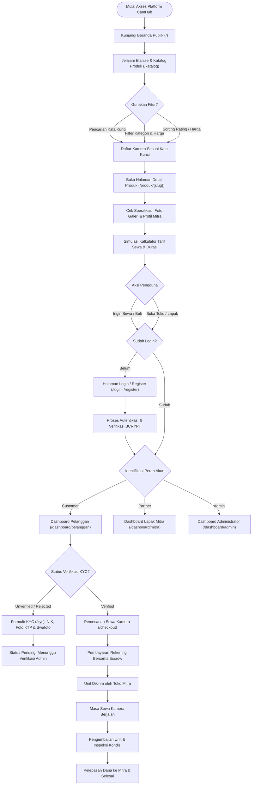
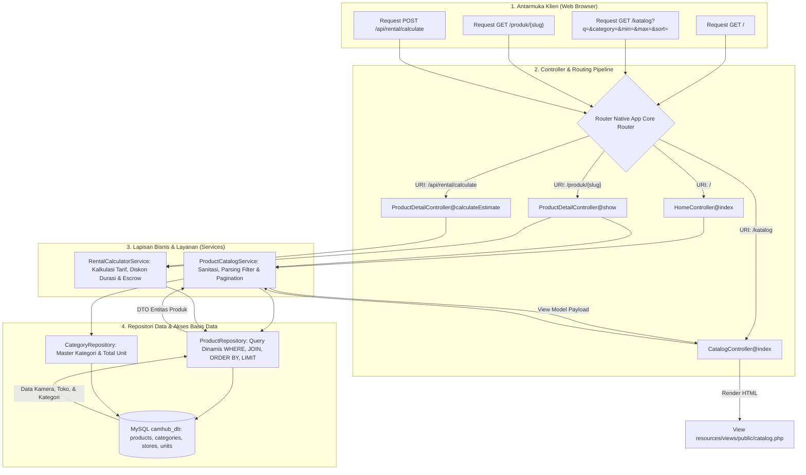
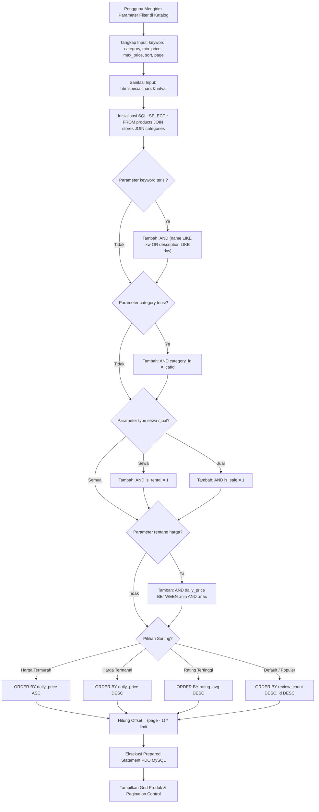
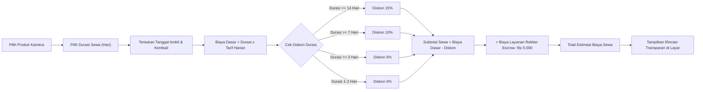
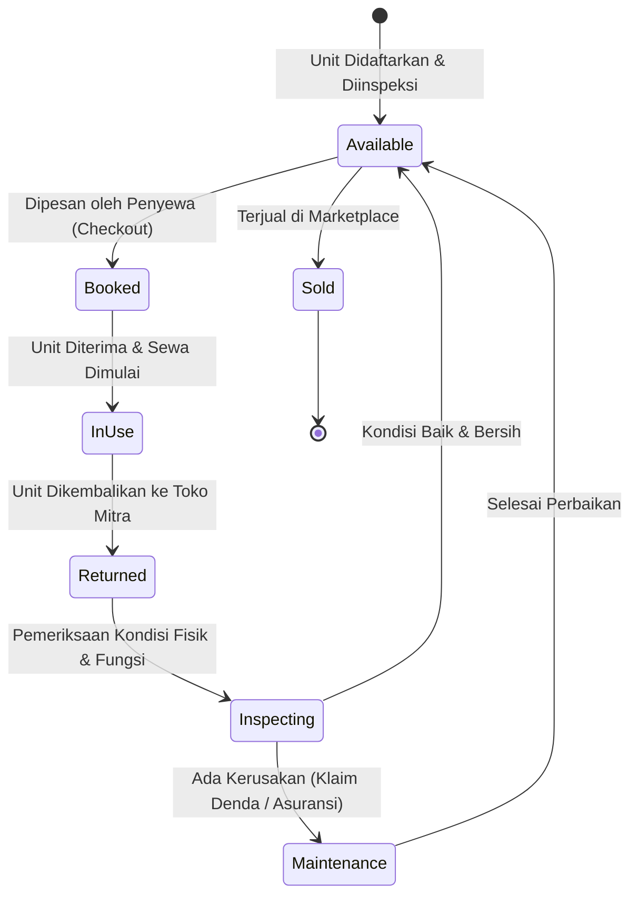
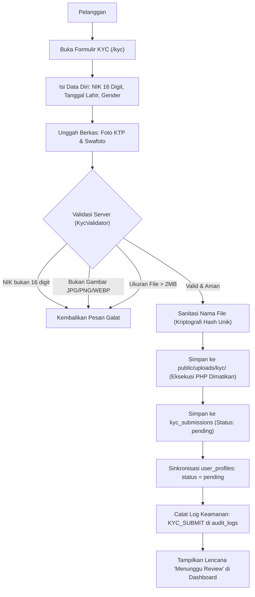
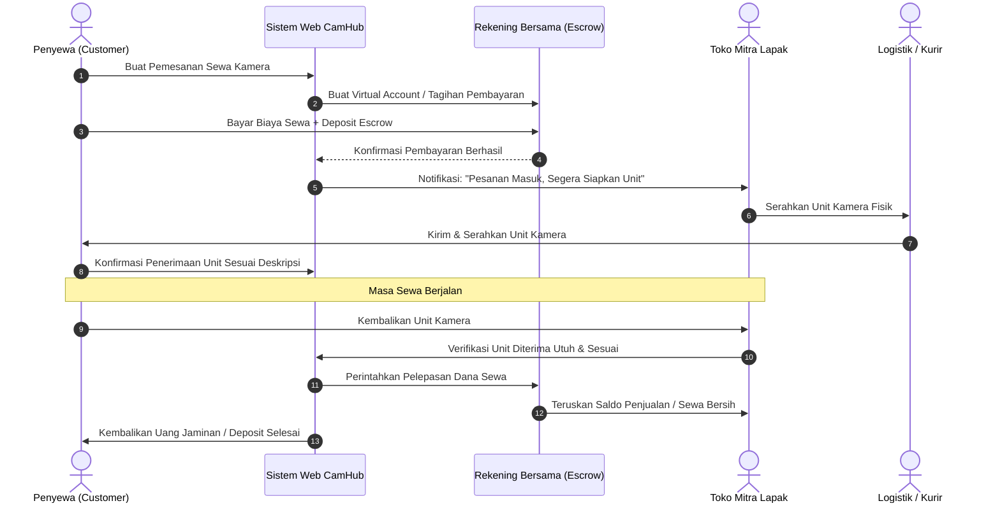

# ARSITEKTUR & DIAGRAM ALUR SISTEM (FLOWCHART) — CAMHUB

> **PROYEK:** CamHub – Camera Marketplace Platform  
> **TIM PENGEMBANG:** Kelompok 1  
> 1. **Yogi Ario Pratama** (Project Owner & Lead Developer)  
> 2. **Muhammad Regieyanto** (Backend & System Architect)  
> 3. **Ivan Farrel Nanda Kristanto** (Core Routing & Security Engineer)  
> 4. **Krisna Mukti** (Quality Assurance & Presentation Coordinator)  
>  
> **LOKASI DOKUMEN:** [`Docs/scema/flowchart.md`](flowchart.md)  
> **DOKUMEN TERKAIT:** [`Docs/scema/ERD.md`](ERD.md) & [`Docs/scema/database_dictionary.md`](database_dictionary.md)  
> **FORMAT:** Mermaid Diagram Code (G规范 GFM Compliant)

---

## 1. Diagram Alur Global Pengguna (Master Platform Flowchart)

Diagram ini menggambarkan alur perjalanan utama (*User Journey*) seluruh aktor dalam ekosistem CamHub: Pengunjung Umum (*Guest*), Pelanggan (*Customer*), Mitra Toko (*Partner*), dan Administrator (*Super Admin*).

---

## 2. Diagram Alur Website Publik & Katalog Produk (Tahap 05 Flowchart)

Diagram ini mengilustrasikan alur pemrosesan data di sisi Front Controller, Router, Service, dan Basis Data saat pengguna menjelajah Beranda, Katalog, dan Detail Produk.

---

## 3. Diagram Alur Logika Filter & Pencarian Katalog

Diagram alur pembuatan query SQL dinamis dan penyaringan data kamera di `CatalogController` dan `ProductRepository`.

---

## 4. Diagram Alur Kalkulator Estimasi Biaya Sewa (Rental Calculator)

Diagram logika perhitungan biaya sewa kamera harian yang transparan dan otomatis.

---

## 5. Diagram Status Unit Fisik Kamera (Unit Lifecycle)

Diagram transisi status unit fisik kamera dari inventaris lapak mitra hingga masa sewa selesai.

---

## 6. Diagram Alur Keamanan & Verifikasi KYC (Tahap 04)

---

## 7. Diagram Alur Transaksi Escrow Rekening Bersama (Tahap 10)

---

## 8. Ringkasan Kepatuhan & Implementasi

| Modul Alur | Diagram Terkait | File Implementasi | Status Kesiapan |
|---|---|---|:---:|
| **Master User Journey** | Bagian 1 | `routes/web.php` | Terintegrasi |
| **Katalog & Website Publik** | Bagian 2 & 3 | `HomeController`, `CatalogController`, `ProductRepository` | **Tahap 05 (Aktif)** |
| **Kalkulator Tarif Sewa** | Bagian 4 | `RentalCalculatorService`, `product_detail.php` | **Tahap 05 (Aktif)** |
| **Siklus Unit Kamera** | Bagian 5 | `product_units`, `rental_bookings` | Siap di MySQL |
| **Verifikasi KYC** | Bagian 6 | `KycController`, `KycValidator`, `KycService` | **Tahap 04 (100% PASS)** |
| **Transaksi Escrow** | Bagian 7 | `payments`, `escrow_accounts`, `orders` | Terstruktur di DB |
