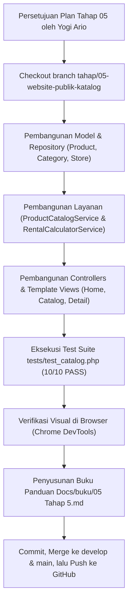

# 05. IMPLEMENTATION PLAN — TAHAP 05: WEBSITE PUBLIK DAN KATALOG PRODUK

> **PROYEK:** CamHub – Camera Marketplace Platform  
> **TIM PENGEMBANG:** Kelompok 1  
> 1. **Yogi Ario Pratama** (Project Owner & Lead Developer)  
> 2. **Muhammad Regieyanto** (Backend & System Architect)  
> 3. **Ivan Farrel Nanda Kristanto** (Core Routing & Security Engineer)  
> 4. **Krisna Mukti** (Quality Assurance & Presentation Coordinator)  
>  
> **NOMOR TAHAP:** 05  
> **NAMA TAHAP:** Website Publik dan Katalog Produk (Beranda, Katalog, dan Detail Produk)  
> **BRANCH TARGET:** `tahap/05-website-publik-katalog` (dicabangkan dari `develop`)  
> **STATUS:** DRAFT — MENUNGGU REVIEW & PERSETUJUAN PROJECT OWNER  
> **TANGGAL PENGAJUAN:** 03 November 2026  
> **DOKUMEN INDUK:** [`Docs/implementation_plan.md`](../implementation_plan.md) & [`Docs/aturan/universal-rule.md`](../aturan/universal-rule.md)  
> **ACUAN MOCKUP PROTOTYPE:**  
> - [`template/CamHub — Interactive UI UX Prototype/CamHub — Beranda.png`](../../template/CamHub%20%E2%80%94%20Interactive%20UI%20UX%20Prototype/CamHub%20%E2%80%94%20Beranda.png)  
> - [`template/CamHub — Interactive UI UX Prototype/CamHub — Katalog Produk.png`](../../template/CamHub%20%E2%80%94%20Interactive%20UI%20UX%20Prototype/CamHub%20%E2%80%94%20Katalog%20Produk.png)  
> - [`template/CamHub — Interactive UI UX Prototype/CamHub — Detail Produk.png`](../../template/CamHub%20%E2%80%94%20Interactive%20UI%20UX%20Prototype/CamHub%20%E2%80%94%20Detail%20Produk.png)  
> **BASIS DATA:** `camhub_db` (Tabel `products`, `product_images`, `product_units`, `categories`, `stores`, `rental_pricing`, `reviews`, `user_profiles`)

---

## 01. Identitas & Ringkasan Tahap

Tahap 05 berfokus pada pembangunan **Website Publik & Etalase Katalog Produk** yang menjadi pintu utama pengunjung dan calon penyewa kamera di platform CamHub. Modul ini menghubungkan antarmuka web secara langsung dengan basis data relasional MySQL `camhub_db` (22 tabel) yang telah disiapkan pada Tahap 02, mencakup:
1. **Halaman Beranda Publik (*Homepage*):** Menampilkan banner hero modern dengan tombol aksi sewa/daftar, navigasi pencarian cepat, kartu kategori fotografi, dan etalase kamera populer disewa sesuai mockup [`CamHub — Beranda.png`](../../template/CamHub%20%E2%80%94%20Interactive%20UI%20UX%20Prototype/CamHub%20%E2%80%94%20Beranda.png).
2. **Halaman Katalog Produk (*Product Catalog*):** Menampilkan etalase produk lengkap dengan sidebar filter multidimensi (kategori, tipe transaksi sewa/beli/titip, filter rentang harga sewa, opsi unit tersedia), sorting (harga terendah/tertinggi, rating, terpopuler), pencarian kata kunci (*search keyword*), dan pagination sesuai mockup [`CamHub — Katalog Produk.png`](../../template/CamHub%20%E2%80%94%20Interactive%20UI%20UX%20Prototype/CamHub%20%E2%80%94%20Katalog%20Produk.png).
3. **Halaman Detail Produk (*Product Detail*):** Menampilkan galeri visual produk interaktif, spesifikasi teknis unit, tab syarat & ketentuan sewa, ulasan penyewa terverifikasi, kartu profil toko mitra, ketersediaan unit fisik real-time, serta kalkulator estimasi biaya sewa (durasi hari, diskon durasi, dan biaya escrow) sesuai mockup [`CamHub — Detail Produk.png`](../../template/CamHub%20%E2%80%94%20Interactive%20UI%20UX%20Prototype/CamHub%20%E2%80%94%20Detail%20Produk.png).

---

## 02. Ruang Lingkup & Batasan Pengerjaan

### 02.01 Termasuk dalam Pengerjaan (In-Scope)
- **Persiapan Branch:** Membuat branch kerja `tahap/05-website-publik-katalog` dari `develop`.
- **Model & Data Layer (Modular PHP Native + PDO):**
  - Model `Product`, `Category`, `Store`, `ProductImage`, `ProductUnit`, `RentalPricing`, `Review`.
  - Repository `ProductRepository` (pencarian, filtering multi-kriteria, sorting, pagination, kueri produk terkait, dan detail unit).
  - Repository `CategoryRepository` (pembacaan daftar kategori beserta hitungan produk aktif).
- **Service Layer (Logika Bisnis):**
  - `ProductCatalogService`: Logika filter katalog, normalisasi parameter harga & kategori, sanitasi query pencarian, dan pembagian halaman (*pagination*).
  - `RentalCalculatorService`: Logika perhitungan estimasi total biaya sewa berdasarkan durasi hari, aturan diskon durasi bertingkat, dan biaya penjaminan escrow Rp 5.000.
- **Controller & Routing:**
  - `HomeController`: Menampilkan halaman beranda dinamis dengan produk unggulan dari MySQL.
  - `CatalogController`: Menangani rute `/katalog` dengan kueri filter dinamis GET (`?q=...&category=...&type=...&min_price=...&max_price=...&sort=...&page=...`).
  - `ProductDetailController`: Menangani rute `/produk/{slug}` dan endpoint AJAX estimasi biaya `/api/rental/calculate`.
- **Antarmuka Pengguna (100% Mockup Prototype):**
  - `resources/views/public/home.php`: Beranda lengkap dengan hero banner, kategori, dan kartu kamera terpopuler.
  - `resources/views/public/catalog.php`: Katalog produk dengan filter sidebar kiri, grid produk responsif kanan, dan navigasi halaman.
  - `resources/views/public/product_detail.php`: Detail produk 2-kolom dengan galeri thumbnail, spesifikasi tab, kartu toko mitra, dan kalkulator estimasi sewa.
- **Otomasi Pengujian Mandiri (100% PASS Gate):** Skrip uji `tests/test_catalog.php` (10 parameter uji DoD).
- **Pengujian Peramban (Browser Testing):** Verifikasi visual dan interaksi langsung melalui Chrome DevTools.
- **Dokumentasi Lengkap:** Buku Panduan & Naskah Presentasi 4 Orang di `Docs/buku/05 Tahap 5.md`.

### 02.02 Tidak Termasuk dalam Pengerjaan (Out-of-Scope)
- Pemrosesan transaksi checkout dan pembayaran payment gateway (dikerjakan pada **Tahap 07: Penyewaan & Pemesanan** dan **Tahap 10: Pembayaran & Escrow**; tombol "Sewa Sekarang" pada Tahap 05 mengarahkan ke alur checkout dengan validasi data sewa).
- Manajemen penambahan produk baru oleh Mitra Lapak (dikerjakan pada **Tahap 06: Dashboard Mitra**).

---

## 03. Analisis Teknis & Pilihan Solusi (Trade-Offs)

### 03.01 Arsitektur Kueri Filter & Pagination Dinamis
- **Tantangan:** Katalog memerlukan filter simultan (pencarian teks pada nama/deskripsi, kategori, jenis transaksi sewa/jual/titip, rentang harga, dan status ketersediaan) tanpa menurunkan performa database.
- **Keputusan Teknis:**
  - Menggunakan query builder dinamis PDO dengan *prepared statements* yang menyusun klausul `WHERE` secara modular dan aman dari SQL Injection.
  - Menyediakan indeks performa yang sudah dibuat pada Tahap 02 (`idx_products_category`, `idx_products_store`, `idx_products_is_rental`, `idx_products_is_sale`).
  - Pagination menggunakan klausul `LIMIT :limit OFFSET :offset` dengan perhitungan total baris via `COUNT(*)`.

### 03.02 Kalkulator Estimasi Biaya Sewa Interaktif
- **Tantangan:** Pengguna membutuhkan estimasi biaya sewa instan ketika memilih durasi (1 hari, 3 hari, 7 hari, 14 hari) atau rentang tanggal ambil dan kembali sebelum melakukan booking.
- **Keputusan Teknis:**
  - Di sisi client (browser), disediakan skrip interaktif JavaScript murni (*vanilla JS*) yang menghitung estimasi secara real-time berdasarkan tarif harian dan diskon durasi.
  - Di sisi server, logika perhitungan dienkapsulasi dalam `RentalCalculatorService` sehingga perhitungan biaya final saat pemesanan selalu terverifikasi secara aman dan konsisten.

### 03.03 Kepatuhan Tampilan Desain Visual (Design System)
- **Keputusan Teknis:**
  - Mengadopsi palet warna resmi CamHub: Primary Navy `#0b192e`, Slate `#1e293b`, Accent Amber `#d97706`, Badge Green `#16a34a`, Background `#f8fafc`.
  - Tata letak komponen, tipografi Plus Jakarta Sans, dan tata ruang grid disesuaikan 100% dengan berkas prototype acuan di `template/`.

---

## 04. Rencana Perubahan Berkas & Direktori

```text
camhub/
├── app/
│   ├── Controllers/
│   │   ├── HomeController.php               # [NEW] Controller Beranda Publik Dinamis
│   │   ├── CatalogController.php            # [NEW] Controller Katalog Produk & Filter
│   │   └── ProductDetailController.php      # [NEW] Controller Detail Produk & Kalkulator
│   ├── Models/
│   │   ├── Product.php                      # [NEW] Model Entitas Produk
│   │   ├── Category.php                     # [NEW] Model Entitas Kategori
│   │   └── Store.php                        # [NEW] Model Entitas Toko Mitra
│   ├── Repositories/
│   │   ├── ProductRepository.php            # [NEW] Kueri Produk, Filter, Unit & Harga
│   │   └── CategoryRepository.php           # [NEW] Kueri Kategori & Hitungan Produk
│   └── Services/
│       ├── ProductCatalogService.php        # [NEW] Layanan Bisnis Katalog & Filter
│       └── RentalCalculatorService.php      # [NEW] Layanan Kalkulasi Tarif Sewa & Diskon
│
├── resources/
│   └── views/
│       ├── public/
│       │   ├── home.php                     # [NEW] Beranda 100% Mockup Beranda.png
│       │   ├── catalog.php                  # [NEW] Katalog 100% Mockup Katalog Produk.png
│       │   └── product_detail.php           # [NEW] Detail 100% Mockup Detail Produk.png
│       └── layouts/
│           ├── header.php                   # [NEW/REFACTOR] Header Navigasi Bersama
│           └── footer.php                   # [NEW/REFACTOR] Footer Bersama Identitas Kelompok 1
│
├── routes/
│   └── web.php                              # [UPDATE] Registrasi rute /, /katalog, /produk/{slug}
│
├── tests/
│   └── test_catalog.php                     # [NEW] Test Suite Otomatis Tahap 05 (10 DoD)
│
└── Docs/
    ├── buku/
    │   └── 05 Tahap 5.md                    # [NEW] Buku Panduan & Naskah Presentasi 4 Orang
    └── tahapan/
        └── 05.implementation_plan_Tahap5.md # [NEW] Salinan Rencana Final di Repositori
```

---

## 05. Skema Rute Web (Routing Matrix)

| Metode HTTP | URI Endpoint | Handler Controller | Middleware Guard | Deskripsi Fungsional |
|:---:|---|---|:---:|---|
| `GET` | `/` | `HomeController@index` | Publik | Beranda publik, hero section, produk sewa populer |
| `GET` | `/katalog` | `CatalogController@index` | Publik | Katalog produk lengkap dengan pencarian, filter, dan pagination |
| `GET` | `/produk/{slug}` | `ProductDetailController@show` | Publik | Detail lengkap spesifikasi kamera, galeri foto, toko, dan formulir booking |
| `POST` | `/api/rental/calculate` | `ProductDetailController@calculateEstimate` | Publik | Endpoint estimasi kalkulasi biaya sewa berdasarkan tanggal/durasi |

---

## 06. Rencana Pengujian Otomatis (Definition of Done — 10 Parameter Uji)

Uji otomatis akan diimplementasikan pada berkas mandiri `tests/test_catalog.php`:

1. **TEST-CAT-01:** Pembacaan Master Kategori Fotografi Aktif dari Database (Mirrorless, DSLR, Lensa, Action Cam, Lighting).
2. **TEST-CAT-02:** Pengambilan Produk Unggulan Beranda (Populer Disewa) dengan Relasi Toko & Kategori.
3. **TEST-CAT-03:** Fungsionalitas Pencarian Kata Kunci (*Keyword Search*) pada Nama & Deskripsi Kamera.
4. **TEST-CAT-04:** Filter Katalog Berdasarkan Kategori (*Category Slug Filtering*).
5. **TEST-CAT-05:** Filter Katalog Berdasarkan Rentang Harga Sewa Harian (*Min Price & Max Price*).
6. **TEST-CAT-06:** Pengurutan Produk (*Sorting*): Harga Termurah, Termahal, dan Rating Tertinggi.
7. **TEST-CAT-07:** Fungsionalitas Pagination Katalog (Limit, Offset, dan Total Halaman).
8. **TEST-CAT-08:** Pengambilan Detail Produk Berdasarkan Slug Unik beserta Galeri Gambar & Data Toko Mitra.
9. **TEST-CAT-09:** Pemeriksaan Ketersediaan Unit Fisik Kamera (*Product Units Availability Status*).
10. **TEST-CAT-10:** Kalkulasi Logika Tarif Sewa & Diskon Durasi (`RentalCalculatorService` + Biaya Escrow Rp 5.000).

---

## 07. Pembagian Peran Tim Pengembang (Kelompok 1)

1. **Yogi Ario Pratama (Project Owner & Lead Developer):**
   - Mengarahkan implementasi desain visual Beranda, Katalog, dan Detail Produk agar presisi 100% dengan mockup.
   - Mengintegrasikan antarmuka galeri foto dan kalkulator estimasi sewa interaktif.
2. **Muhammad Regieyanto (Backend & System Architect):**
   - Membangun model `Product`, `Category`, `Store`, serta repositori `ProductRepository` dengan query filter SQL optimal.
   - Merancang logika bisnis `RentalCalculatorService` dan penanganan diskon durasi sewa.
3. **Ivan Farrel Nanda Kristanto (Core Routing & Security Engineer):**
   - Mengonfigurasi parameter rute bersih `/katalog` dan `/produk/{slug}` pada router native.
   - Memastikan sanitasi input pencarian dan pencegahan XSS pada parameter query string.
4. **Krisna Mukti (Quality Assurance & Presentation Coordinator):**
   - Menyusun skrip uji otomatis `tests/test_catalog.php` (10 DoD).
   - Menyusun buku panduan dan naskah presentasi 4 orang di `Docs/buku/05 Tahap 5.md`.

---

## 08. Rencana Eksekusi Bertahap (Step-by-Step)



---

## 09. Formulir Masukan & Catatan Khusus Project Owner

Silakan berikan tanggapan, kritik, atau catatan khusus sebelum eksekusi coding dimulai:

- [ ] **Desain & Tampilan:** Apakah ada elemen visual khusus dari mockup `Beranda`, `Katalog`, atau `Detail Produk` yang ingin ditonjolkan?
- [ ] **Stok & Unit Kamera:** Apakah ada variasi kamera tambahan di luar 6 kamera default yang ingin ditampilkan?
- [ ] **Kalkulator Sewa:** Apakah formula durasi sewa (1 hari, 3 hari, 7 hari, 14 hari) sudah sesuai dengan skenario bisnis kelompok?

*Ketik komentar Anda atau klik **Proceed / Setujui** untuk memulai eksekusi.*

