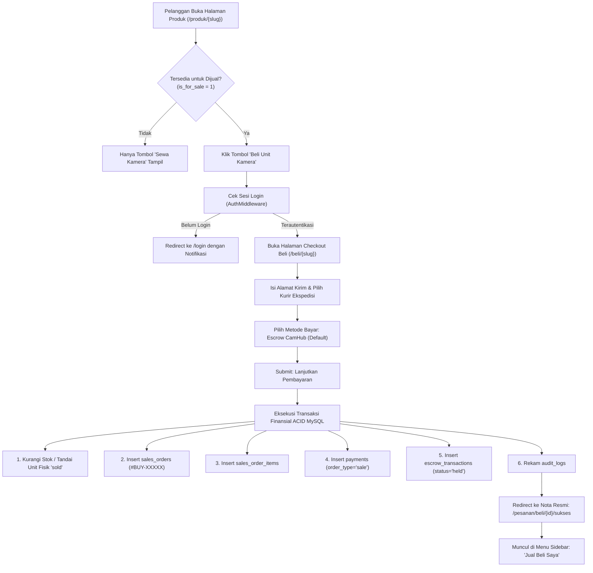

# 08. IMPLEMENTATION PLAN — TAHAP 08: MARKETPLACE JUAL BELI KAMERA (SECOND & BARU)

> **NAMA PROYEK:** CamHub – Camera Marketplace Platform  
> **TIM PENGEMBANG (KELOMPOK 1):**  
> 1. **Yogi Ario Pratama** — *Project Owner & Lead Developer*  
> 2. **Muhammad Regieyanto** — *Backend & System Architect*  
> 3. **Ivan Farrel Nanda Kristanto** — *Core Routing & Security Engineer*  
> 4. **Krisna Mukti** — *Quality Assurance & Presentation Coordinator*  
>  
> **TARGET MILESTONE:** Tahap 08 — Marketplace Jual Beli Kamera  
> **BRANCH RESMI GIT:** `tahap/08-marketplace-jual-beli` (dibuat dari `develop`)  
> **ACUAN PROTOTYPE RESMI:**  
> - [`template/CamHub — Interactive UI UX Prototype/CamHub — Detail Produk.png`](../../template/CamHub%20%E2%80%94%20Interactive%20UI%20UX%20Prototype/CamHub%20%E2%80%94%20Detail%20Produk.png) (Opsi Beli Unit & Informasi Garansi Fisik)  
> - [`template/CamHub — Interactive UI UX Prototype/CamHub — Booking & Checkout.png`](../../template/CamHub%20%E2%80%94%20Interactive%20UI%20UX%20Prototype/CamHub%20%E2%80%94%20Booking%20&%20Checkout.png) (Struktur Checkout 2 Kolom Ringkasan Biaya)  
> - [`template/CamHub — Interactive UI UX Prototype/CamHub — Dashboard Pelanggan.png`](../../template/CamHub%20%E2%80%94%20Interactive%20UI%20UX%20Prototype/CamHub%20%E2%80%94%20Dashboard%20Pelanggan.png) (Menu Navigasi Sidebar *Jual Beli Saya* & Status Pembelian Unit)  
>  
> **TABEL TERKAIT:** `products`, `product_units`, `sales_orders`, `sales_order_items`, `payments`, `escrow_transactions`, `partner_stores`, `users`, `audit_logs`

---

## 1. Latar Belakang & Nilai Bisnis Tahap 08

Pada Tahap 05, 06, dan 07, ekosistem penyewaan kamera (*rental*) telah beroperasi penuh dengan alokasi unit bebas tabrakan dan penahanan dana di rekening bersama Escrow. 

**Tahap 08 melengkapi pilar transaksi kedua CamHub: Marketplace Jual Beli Kamera (Second Terverifikasi & Baru).**
Pelanggan tidak hanya dapat menyewa kamera, tetapi juga dapat membeli kamera langsung dari Toko Mitra dengan jaminan:
1. **Verifikasi Kondisi Unit Fisik:** Setiap kamera second memiliki grading kondisi fisik nyata (`like_new`, `good`, `fair`), kelengkapan aksesori, dan nomor seri resmi.
2. **Rekening Bersama Escrow Pembelian:** Dana pembeli ditahan aman di CamHub Escrow hingga paket kamera sampai di alamat pembeli dan diperiksa kondisinya.
3. **Pengelolaan Terpusat di Sidebar Pelanggan:** Pesanan jual beli tercatat rapi di menu sidebar **"Jual Beli Saya"** pada Dashboard Pelanggan yang telah diselaraskan 100% presisi dengan prototype.

---

## 2. Diagram Alur Transaksi Jual Beli (Mermaid Flowchart)



---

## 3. Spesifikasi Arsitektur & Komponen Teknis

### A. Model Data Baru & Diperbarui
1. `App\Models\SalesOrder`:
   - Representasi entitas pesanan pembelian (`id`, `user_id`, `order_number`, `subtotal`, `admin_fee`, `total_amount`, `order_status`, `shipping_address`, `created_at`).
   - Helper format rupiah, status badge, dan invoice code generator `#BUY-` + str_pad(id, 5, '0', STR_PAD_LEFT).
2. `App\Models\SalesOrderItem`:
   - Representasi rincian barang per order (`order_id`, `product_id`, `quantity`, `unit_price`, `subtotal`).

### B. Repositori Data (`App\Repositories\SalesRepository`)
- `findProductForSale(string $slug): ?array`: Mengambil kamera yang berstatus aktif dan `is_for_sale = 1`.
- `createSalesOrderWithTransaction(array $orderData, array $itemData, array $paymentData): int`:
  - Membuka transaksi `PDO::beginTransaction()`.
  - Mengunci unit fisik kamera atau memotong kuantitas stok.
  - Menyimpan ke `sales_orders`, `sales_order_items`, `payments` (reference_id = order_id, order_type = 'sale'), dan `escrow_transactions` (amount_held = subtotal, status = 'held').
  - Mencatat rekam jejak ke `audit_logs`.
  - Melakukan `PDO::commit()` atau `PDO::rollBack()` jika terjadi anomali.
- `findOrderById(int $orderId, ?int $userId = null): ?array`: Kueri detail pesanan lengkap dengan nama toko, alamat pengiriman, dan rincian pembayaran.
- `getUserSalesOrders(int $userId): array`: Mengambil seluruh transaksi pembelian milik akun pelanggan untuk ditampilkan pada tab *Jual Beli Saya*.

### C. Validasi Formulir (`App\Validators\SalesValidator`)
- Nama penerima: Wajib, minimal 3 karakter.
- Nomor HP: Wajib, format nomor Indonesia (08xx atau +62).
- Alamat pengiriman lengkap: Wajib, minimal 10 karakter.
- Kota / Provinsi: Wajib dipilih.
- Metode pembayaran: Wajib salah satu dari `escrow`, `bank_transfer`, `ewallet`.

### D. Layanan Bisnis (`App\Services\SalesService`)
- Orkestrasi kalkulasi total pembelian: `Harga Kamera + Ongkos Kirim (Flat estimasi) + Biaya Admin Escrow (Rp 5.000)`.
- Validasi ketersediaan stok kamera sebelum eksekusi pesanan.

### E. Pengontrol (`App\Controllers\SalesController`)
- `checkout(string $slug): string`: Menampilkan formulir checkout 2 kolom pembelian kamera.
- `processCheckout(string $slug): void`: Memproses validasi POST, eksekusi transaksi ACID, dan pengalihan ke halaman receipt.
- `success(int $id): string`: Menampilkan nota resmi `#BUY-XXXXX` dengan status Rekening Bersama Escrow.
- `customerPurchases(): string`: Menampilkan riwayat pembelian di `/pesanan-saya?type=sale`.

---

## 4. Spesifikasi Tampilan Antarmuka (UI/UX)

1. **Tombol "Beli Kamera Ini" di Detail Produk (`resources/views/public/product_detail.php`):**
   - Menambahkan tombol aksi sekunder di samping tombol sewa untuk produk yang memiliki opsi `is_for_sale = 1` dengan label tarif beli (misal: `Beli Unit Rp 18.500.000`).
2. **Formulir Checkout Pembelian (`resources/views/sales/checkout.php`):**
   - Mengadopsi struktur 2 kolom persis prototype `CamHub — Booking & Checkout.png`:
     - Kolom Kiri: Informasi Pengiriman (Nama Penerima, No. HP, Alamat Pengiriman, Catatan untuk Toko Mitra, dan Pilihan Pembayaran Rekening Bersama Escrow terpilih default).
     - Kolom Kanan: Ringkasan Pembelian Sticky (`Sony A7 III · Unit Fisik Second Mulus`, Subtotal Barang, Ongkos Kirim Flat Rp 25.000, Biaya Layanan Escrow Rp 5.000, Total Pembayaran biru bold 32px, tombol *Lanjutkan Pembayaran*, dan banner garansi dana aman).
3. **Nota Konfirmasi Pembelian (`resources/views/sales/success.php`):**
   - Menampilkan kode pesanan resmi `#BUY-XXXXX`, toko penjual, alamat tujuan pengiriman, estimasi waktu pengiriman, serta panduan konfirmasi penerimaan barang.
4. **Integrasi Sidebar Dashboard Pelanggan (`resources/views/customer/dashboard.php` & `orders.php`):**
   - Tab *Jual Beli Saya* aktif dan menampilkan kartu barang yang dibeli dengan badge `Dalam proses`, `Dikirim`, atau `Selesai` persis seperti pada kartu tengah di mockup `CamHub — Dashboard Pelanggan.png`.

---

## 5. Rute Web Baru (`routes/web.php`)

```php
// Rute Marketplace Jual Beli Kamera (Tahap 08)
Router::get('/beli/{slug}', [SalesController::class, 'checkout'], ['auth']);
Router::post('/beli/{slug}/proses', [SalesController::class, 'processCheckout'], ['auth']);
Router::get('/pesanan/beli/{id}/sukses', [SalesController::class, 'success'], ['auth']);
Router::get('/jual-beli-saya', [SalesController::class, 'customerPurchases'], ['auth']);
```

---

## 6. Definition of Done (10 Test Cases — `tests/test_marketplace.php`)

| Kode Test | Deskripsi Skenario Pengujian | Hasil yang Diharapkan |
|---|---|---|
| **TEST-SALE-01** | Proteksi Hak Akses Checkout Pembelian | Pengguna tanpa sesi diarahkan ke `/login`. |
| **TEST-SALE-02** | Validasi Kamera Tersedia untuk Dijual | Hanya produk dengan `is_for_sale = 1` yang dapat dibeli. |
| **TEST-SALE-03** | Auto-fill Data Pembeli & Alamat Domisili | Data profil pembeli terisi otomatis pada formulir checkout. |
| **TEST-SALE-04** | Validasi Formulir Server-Side Bahasa Indonesia | Menolak input kosong (penerima, no HP tidak valid, alamat kosong). |
| **TEST-SALE-05** | Presisi Kalkulasi Biaya Jual Beli | Subtotal produk + Ongkir + Biaya Admin Escrow Rp 5.000 dihitung akurat. |
| **TEST-SALE-06** | Transaksi ACID Penulisan `sales_orders` | Data order tersimpan dengan nomor pesanan `#BUY-XXXXX`. |
| **TEST-SALE-07** | Rincian Item pada `sales_order_items` | Produk ID, kuantitas, dan harga satuan tersimpan sesuai relasi FK. |
| **TEST-SALE-08** | Penahanan Dana Rekening Bersama Escrow | Record tersimpan di `escrow_transactions` dengan status `held`. |
| **TEST-SALE-09** | Otorisasi Nota Tanda Terima Pembelian | Hanya pemilik akun yang dapat mengakses nota pesanannya. |
| **TEST-SALE-10** | Tampilan Transaksi di Menu "Jual Beli Saya" | Transaksi pembelian tampil pada daftar pesanan pelanggan. |

---

## 7. Rencana Uji Regresi Kumulatif (Target: 91 / 91 PASS)

1. `test_foundation.php` (7/7 PASS)
2. `test_database.php` (7/7 PASS)
3. `test_auth.php` (10/10 PASS)
4. `test_kyc.php` (10/10 PASS)
5. `test_catalog.php` (10/10 PASS)
6. `test_partner_dashboard.php` (10/10 PASS)
7. `test_booking.php` (10/10 PASS)
8. `test_marketplace.php` (10/10 PASS — Modul Baru)
9. `test_browser_e2e.php` (17/17 PASS)
**TOTAL AKUMULATIF:** **91 / 91 TESTS LULUS (100% SUKSES)**.

---

## 8. Jadwal & Pembagian Tanggung Jawab Kelompok 1

- **Yogi Ario Pratama (Project Owner & Lead Developer):** Memimpin penyelarasan tampilan checkout pembelian dan nota receipt mengacu pada prototype `CamHub — Booking & Checkout.png`.
- **Muhammad Regieyanto (Backend & System Architect):** Merancang transaksi ACID MySQL pada `sales_orders`, `sales_order_items`, `payments`, dan `escrow_transactions`.
- **Ivan Farrel Nanda Kristanto (Core Routing & Security Engineer):** Mengamankan rute pembelian, validasi formulir ekspedisi pengiriman, dan proteksi anti-IDOR nota pesanan.
- **Krisna Mukti (Quality Assurance & Presentation Coordinator):** Menyusun test runner `tests/test_marketplace.php`, memverifikasi 10 DoD, serta menulis buku panduan `Docs/buku/08 Tahap 8.md`.

