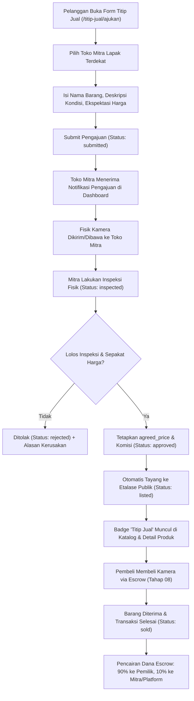

# 09. IMPLEMENTATION PLAN — TAHAP 09: SISTEM TITIP JUAL KAMERA (CONSIGNMENT) & PENYELARASAN TOTAL DASHBOARD ADMIN

> **NAMA PROYEK:** CamHub – Camera Marketplace Platform  
> **TIM PENGEMBANG (KELOMPOK 1):**  
> 1. **Yogi Ario Pratama** — *Project Owner & Lead Developer*  
> 2. **Muhammad Regieyanto** — *Backend & System Architect*  
> 3. **Ivan Farrel Nanda Kristanto** — *Core Routing & Security Engineer*  
> 4. **Krisna Mukti** — *Quality Assurance & Presentation Coordinator*  
>  
> **PRINSIP OPERASIONAL DASAR & INTEGRITAS REKAYASA:**  
> - **No Plan, No Code. No Approval, No Code.** Rencana harus disepakati sebelum kode ditulis.  
> - **No Evidence, No Completion.** Pekerjaan tidak boleh dinyatakan selesai tanpa bukti verifikasi yang sesuai (pengujian otomatis, verifikasi visual browser, audit database).  
> - **No Superfluous AI Boilerplate.** Jangan menambahkan elemen formalitas tambahan, blok komentar yang tidak perlu, atau boilerplate artifisial yang tidak ada pada panduan penugasan agar tetap natural, otentik, dan tidak tampak seperti hasil generasi instan AI.  
>  
> **TARGET MILESTONE:** Tahap 09 — Sistem Titip Jual Kamera & Perbaikan Panel Admin  
> **BRANCH RESMI GIT:** `tahap/09-sistem-titip-jual` (dibuat dari `develop`)  
> **ACUAN PROTOTYPE RESMI:**  
> - [`template/CamHub — Interactive UI UX Prototype/CamHub — Dashboard Admin.png`](../../template/CamHub%20%E2%80%94%20Interactive%20UI%20UX%20Prototype/CamHub%20%E2%80%94%20Dashboard%20Admin.png) (Acuan Mutlak Tampilan Panel Admin: Sidebar Navy Slate `#0c192c`, 4 Metric Cards 2x2, Bar Chart 7 Hari Terakhir, disertai tombol Logout bersih)  
> - [`template/CamHub — Interactive UI UX Prototype/CamHub — Dashboard Pelanggan.png`](../../template/CamHub%20%E2%80%94%20Interactive%20UI%20UX%20Prototype/CamHub%20%E2%80%94%20Dashboard%20Pelanggan.png) (Sudah benar dari Tahap 08, pertahankan tatanan sidebar *Titip Jual Saya* & Pelacak Status tanpa mengubah tatanan yang sudah rapi)  
> - [`template/CamHub — Interactive UI UX Prototype/CamHub — Dashboard Mitra Lapak.png`](../../template/CamHub%20%E2%80%94%20Interactive%20UI%20UX%20Prototype/CamHub%20%E2%80%94%20Dashboard%20Mitra%20Lapak.png) (Pertahankan tampilan sesuai prototype, tambahkan tombol Logout yang rapi di navigasi)  
> - [`template/CamHub — Interactive UI UX Prototype/CamHub — Katalog Produk.png`](../../template/CamHub%20%E2%80%94%20Interactive%20UI%20UX%20Prototype/CamHub%20%E2%80%94%20Katalog%20Produk.png) (Badge Penanda Unit *Titip Jual* Terverifikasi di Etalase Publik)  
>  
> **TABEL TERKAIT:** `consignments`, `products`, `product_units`, `inspections`, `partner_stores`, `users`, `kyc_verifications`, `payments`, `rental_fines`, `escrow_transactions`, `audit_logs`

---

## 1. Analisis Permasalahan & Temuan UI Saat Ini

Berdasarkan tinjauan tangkapan layar yang dikirimkan Pengguna pada `http://localhost/camhub/public/dashboard/admin` dan perbandingannya dengan prototype resmi:

```
[KONDISI SEKARANG (DRAF TAHAP 3)]                [TARGET RESMI (CamHub — Dashboard Admin.png)]
----------------------------------------------   -------------------------------------------------
- Menggunakan navbar horizontal atas gelap       - Layout 2 kolom: Sidebar Gelap Kiri + Konten Kanan
- Hero card besar "Dashboard Kontrol Admin"      - Sidebar Navy Gelap (#0c192c) dengan brand CamHub
- 3 Kartu metrik horizontal (Pengguna, KYC,     - 7 Menu vertikal: Beranda, Verifikasi KYC, Jadwal Unit,
  Escrow) dengan warna kuning kaku                 Transaksi, Manajemen Denda, Laporan, Pengaturan
- Tombol aksi berceceran di baris bawah          - Judul bersih: "Dashboard Admin" (Slate-900)
- TIDAK ADA grafik atau statistik visual         - 4 Kartu Metrik Grid 2x2 (Putih Bersih, Border Halus):
- Belum memiliki Controller khusus                 1. Menunggu Verifikasi KYC (8)
  (masih Closure inline di routes/web.php)         2. Unit Inspeksi (5)
                                                   3. Transaksi Hari Ini (12)
                                                   4. Denda Pending (3)
                                                 - Bagian Bawah: Kartu "Transaksi 7 Hari Terakhir"
                                                   dengan Bar Chart Vertikal Biru Modern (Sen - Min)
```

> [!IMPORTANT]
> **Komitmen Penyelarasan:** Tampilan Dashboard Admin pada Tahap 09 akan dibangun ulang secara radikal agar **100% presisi dan identik** dengan `CamHub — Dashboard Admin.png`, didukung oleh Controller tersendiri (`App\Controllers\AdminDashboardController`) dengan data statistik riil dari database.

---

## 2. Ruang Lingkup Fitur Tahap 09

### Bagian A: Perbaikan Total Panel Admin Dashboard (100% Mockup)
1. **Sidebar Navigasi Kiri (`#0c192c`):**
   - Brand Header: `CamHub` (Putih, 24px, Font Extra Bold).
   - Menu Navigasi:
     - `Beranda` (Status Aktif / Halaman Utama Dashboard Admin).
     - `Verifikasi KYC` (Tautan ke peninjauan dokumen identitas KTP/SIM pelanggan).
     - `Jadwal Unit` (Tautan ke visualisasi kalender ketersediaan unit sewa).
     - `Transaksi` (Tautan ke pengawasan transaksi sewa, jual-beli, dan saldo escrow).
     - `Manajemen Denda` (Tautan ke penetapan denda keterlambatan/kerusakan unit).
     - `Laporan` (Tautan ke laporan audit keuangan dan performa toko mitra).
     - `Pengaturan` (Tautan ke profil administrator dan sistem).
   - Profil Admin & Tombol Logout bersih di bagian bawah sidebar.
2. **Kartu Metrik Utama (Grid 2 Kolom x 2 Baris):**
   - **Kartu 1:** `Menunggu Verifikasi KYC` — Menghitung jumlah permohonan KYC berstatus `submitted` / `pending`.
   - **Kartu 2:** `Unit Inspeksi` — Menghitung unit kamera yang sedang dalam proses inspeksi (titip jual atau purna sewa).
   - **Kartu 3:** `Transaksi Hari Ini` — Menghitung total transaksi pembayaran (sewa + jual beli) pada hari berjalan (`CURDATE()`).
   - **Kartu 4:** `Denda Pending` — Menghitung total denda penyewa yang belum diselesaikan (`is_paid = 0`).
3. **Grafik Batang Transaksi 7 Hari Terakhir:**
   - Wadah kartu putih berlatar bersih dengan sudut melengkung halus (`rounded-2xl`).
   - 7 Kolom bar vertikal dengan warna biru khas CamHub (`#2563eb`) berujung melengkung.
   - Label hari: `Sen`, `Sel`, `Rab`, `Kam`, `Jum`, `Sab`, `Min`.
   - Menghitung jumlah transaksi per hari secara dinamis dari tabel `payments`.

---

### Bagian B: Sistem Titip Jual Kamera (Consignment)
Sistem Titip Jual memungkinkan pemilik kamera (pelanggan perorangan) menitipkan unit kameranya ke Toko Mitra terverifikasi untuk dipasarkan melalui CamHub dengan pembagian komisi transparan (standar 10%).



#### Tahapan Siklus Hidup Konsinyasi (`consignments.status`):
1. **`submitted` (Diajukan):** Pelanggan mengisi formulir titip jual dan memilih toko mitra penampung.
2. **`inspected` (Inspeksi Fisik):** Toko mitra menerima unit fisik dan mencatat hasil pengecekan sensor, optik, fisik, dan shutter count.
3. **`approved` (Harga Disepakati):** Toko mitra dan pemilik menyepakati harga jual final (`agreed_price`) dan persentase komisi (`commission_percent`, standar 10%).
4. **`listed` (Tayang di Etalase):** Kamera otomatis dikonversi menjadi entitas produk aktif di tabel `products` (`is_sale = 1`, `is_consignment = 1`) dengan badge "Titip Jual".
5. **`sold` (Terjual & Cair):** Unit berhasil dibeli oleh pelanggan lain melalui alur checkout escrow, dan hasil penjualan dialokasikan ke pemilik kamera setelah dipotong komisi mitra.
6. **`rejected` (Ditolak):** Jika unit kamera tidak memenuhi standar kelayakan fisik/operasional toko mitra.

---

## 3. Rencana Arsitektur & Perubahan Berkas

### A. Lapisan Model (`app/Models/`)
1. **`App\Models\Consignment.php` (Baru):**
   - Atribut: `id`, `user_id`, `store_id`, `item_name`, `item_description`, `requested_price`, `agreed_price`, `commission_percent`, `status`, `approved_at`, `created_at`.
   - Method pembantu: label status badge Indonesia, format rupiah harga permintaan & harga kesepakatan, kalkulasi estimasi dana bersih pemilik (`net_payout`).
2. **Pembaruan `App\Models\Product.php`:**
   - Menambahkan helper `isConsignment(): bool` untuk memunculkan badge khusus Titip Jual pada kartu katalog dan halaman detail produk.

### B. Lapisan Repositori (`app/Repositories/`)
1. **`App\Repositories\ConsignmentRepository.php` (Baru):**
   - `create(array $data): int`: Menyimpan pengajuan titip jual baru pelanggan.
   - `findById(int $id): ?array`: Mengambil detail titip jual lengkap dengan relasi pemilik dan toko mitra.
   - `findByUserId(int $userId): array`: Mengambil seluruh riwayat titip jual milik pelanggan yang sedang login.
   - `findByStoreId(int $storeId, ?string $status = null): array`: Mengambil daftar pengajuan titip jual masuk untuk toko mitra.
   - `updateInspectionAndPrice(int $id, float $agreedPrice, float $commissionPercent, string $notes): bool`: Memperbarui status ke `approved` / `inspected`.
   - `publishToCatalog(int $consignmentId, int $categoryId): int`: Transaksi ACID untuk menyetujui titip jual dan meng-insert entitas produk publik di `products` (`is_consignment = 1`, `is_sale = 1`).
   - `markAsSold(int $consignmentId): bool`: Memperbarui status menjadi `sold`.
2. **`App\Repositories\AdminRepository.php` (Baru):**
   - `getDashboardMetrics(): array`: Mengambil data agregat riil:
     - `kyc_pending`: Menghitung `kyc_verifications` berstatus pending.
     - `inspection_units`: Menghitung `inspections` dalam proses atau unit kamera maintenance/consignment.
     - `today_transactions`: Menghitung `payments` hari ini (`DATE(created_at) = CURDATE()`).
     - `pending_fines`: Menghitung `rental_fines` berstatus `is_paid = 0`.
   - `getLast7DaysTransactionStats(): array`: Agregasi volume transaksi 7 hari terakhir (Senin s/d Minggu) untuk render bar chart.

### C. Lapisan Validasi (`app/Validators/`)
1. **`App\Validators\ConsignmentValidator.php` (Baru):**
   - Validasi nama barang (wajib, min 5 karakter, maks 150 karakter).
   - Validasi toko mitra (wajib dipilih, toko harus terdaftar dan aktif).
   - Validasi deskripsi kondisi (wajib, min 20 karakter).
   - Validasi harga yang diminta (wajib numerik, minimal Rp 100.000).

### D. Lapisan Layanan Bisnis (`app/Services/`)
1. **`App\Services\ConsignmentService.php` (Baru):**
   - Orkestrasi alur pengajuan dari pelanggan.
   - Validasi hak akses (apakah pengaju adalah pemilik barang, apakah pemroses adalah pemilik toko mitra tujuan).
   - Perhitungan komisi bagi hasil otomatis (`agreed_price * (commission_percent / 100)`).
   - Otomasi publikasi barang ke katalog setelah disetujui.

### E. Lapisan Pengontrol (`app/Controllers/`)
1. **`App\Controllers\AdminDashboardController.php` (Baru):**
   - `index()`: Mengambil metrik dinamis dan data grafik 7 hari, lalu me-render tampilan dashboard admin baru yang 100% presisi dengan mockup.
2. **`App\Controllers\ConsignmentController.php` (Baru):**
   - `create()`: Menampilkan formulir pengajuan titip jual pelanggan.
   - `store()`: Memproses pengajuan titip jual baru.
   - `customerConsignments()`: Menampilkan riwayat titip jual pelanggan di menu "Titip Jual Saya".
   - `partnerConsignments()`: Menampilkan antarmuka toko mitra untuk meninjau pengajuan titip jual masuk.
   - `partnerInspect()`: Menyimpan hasil inspeksi dan persetujuan harga dari mitra.

### F. Lapisan Tampilan Antarmuka (Views)
1. **`resources/views/admin/dashboard.php` (Refactor Total):**
   - Menerapkan layout 2 kolom presisi sesuai mockup: Sidebar navy slate `#0c192c` + 4 Metric Cards (2x2) + Bar Chart 7 Hari Terakhir `#2563eb` + Tombol Logout bersih di bagian bawah navigasi admin.
2. **`resources/views/partner/dashboard.php` (Pembaruan Sesuai Catatan User):**
   - Tampilan tetap 100% mempertahankan desain prototype `CamHub — Dashboard Mitra Lapak.png` tanpa merusak tatanan yang sudah rapi, dengan **penambahan tombol Logout** yang terpasang rapi dan fungsional.
3. **`resources/views/customer/dashboard.php` (Konfirmasi Status):**
   - Sesuai arahan: *Sudah benar jangan diubah*. Seluruh tatanan navigasi, 3 kartu metrik, dan layout sidebar dipertahankan utuh, hanya menghubungkan tab *Titip Jual Saya* ke modul konsinyasi baru.
4. **`resources/views/customer/consignment_form.php` (Baru):**
   - Formulir pengajuan titip jual dengan antarmuka elegan, pilihan mitra, dan panduan komisi.
5. **`resources/views/customer/consignment_list.php` (Baru):**
   - Pelacak status titip jual pelanggan yang terintegrasi di Dashboard Pelanggan (Tab *Titip Jual Saya*).
6. **`resources/views/partner/consignments.php` (Baru):**
   - Panel mitra lapak untuk memverifikasi kondisi kamera, menetapkan harga kesepakatan, dan memublikasikan ke katalog.
7. **Pembaruan `resources/views/public/catalog.php` & `product_detail.php`:**
   - Menampilkan badge oranye elegan bertuliskan **"Titip Jual"** pada produk konsinyasi.

---

## 4. Definisi Selesai & Rencana Pengujian Otomatis (DoD)

Pengujian dilakukan melalui berkas pengujian otomatis `tests/test_consignment.php` yang mencakup 10 skenario:

| No | Skenario Pengujian | Hasil yang Diharapkan |
|:---|:---|:---|
| 1 | **Akses Dashboard Admin Baru** | Rute `/dashboard/admin` mengembalikan status 200 OK dengan markup sidebar `#0c192c` dan judul "Dashboard Admin". |
| 2 | **Integritas 4 Kartu Metrik Admin** | Halaman admin menampilkan 4 label kartu: *Menunggu Verifikasi KYC*, *Unit Inspeksi*, *Transaksi Hari Ini*, dan *Denda Pending*. |
| 3 | **Struktur Bar Chart 7 Hari** | Kartu *Transaksi 7 Hari Terakhir* ter-render dengan 7 label hari (`Sen`, `Sel`, `Rab`, `Kam`, `Jum`, `Sab`, `Min`). |
| 4 | **Formulir Pengajuan Titip Jual** | Halaman `/titip-jual/ajukan` dapat diakses oleh pelanggan terotentikasi dan menampilkan daftar toko mitra aktif. |
| 5 | **Validasi Data Titip Jual** | Sistem menolak input kosong, harga di bawah ketentuan, atau deskripsi barang yang tidak memadai. |
| 6 | **Perekaman Pengajuan Konsinyasi** | Pengajuan titip jual tersimpan di tabel `consignments` dengan status awal `submitted` dan relasi user/store yang valid. |
| 7 | **Pelacakan Status di Sisi Pelanggan** | Pelanggan dapat memantau status pengajuannya di `/titip-jual/saya` lengkap dengan estimasi harga dan status terkini. |
| 8 | **Inspeksi & Persetujuan Toko Mitra** | Mitra toko dapat menginput hasil inspeksi, menetapkan `agreed_price`, dan komisi 10% (status berubah menjadi `approved`). |
| 9 | **Publikasi Otomatis ke Katalog** | Produk konsinyasi yang disetujui otomatis terbit di tabel `products` dengan `is_consignment = 1` dan muncul di katalog publik. |
| 10 | **Audit Log & Proteksi RBAC Konsinyasi** | Pelanggan tidak dapat menyetujui barangnya sendiri, dan setiap perubahan status titip jual tercatat dalam `audit_logs`. |

**Target Akumulatif Pengujian:**
- Total tes saat ini: **91 / 91 PASS**
- Tambahan tes Tahap 09: **10 / 10 PASS**
- **Target Akumulatif Platform: 101 / 101 PASS (100% SUKSES, 0 GAGAL)**

---

## 5. Tata Kelola Git & Pembagian Peran Anggota Tim (Kelompok 1)

1. **Yogi Ario Pratama (Project Owner & Lead Developer):**
   - Mengawasi kepatuhan 100% desain antarmuka Dashboard Admin terhadap prototype `CamHub — Dashboard Admin.png`.
   - Menguji interaktivitas form titip jual pelanggan dan integrasi katalog publik.
2. **Muhammad Regieyanto (Backend & System Architect):**
   - Merancang skema transaksi ACID repositori konsinyasi, integrasi tabel `consignments`, dan layanan `ConsignmentService`.
3. **Ivan Farrel Nanda Kristanto (Core Routing & Security Engineer):**
   - Mengamankan rute admin dengan RBAC terisolasi, `AdminDashboardController`, validasi token CSRF, dan sanitasi XSS.
4. **Krisna Mukti (Quality Assurance & Presentation Coordinator):**
   - Menjalankan rangkaian uji otomatis `test_consignment.php`, verifikasi browser nyata, penyusunan buku panduan Tahap 09, dan pembaruan berkas riwayat proyek.

---

> [!NOTE]
> **Instruksi Baku Operasional:**  
> - **No Plan, No Code. No Approval, No Code.**  
> - **No Evidence, No Completion.** Pekerjaan tidak boleh dinyatakan selesai tanpa bukti verifikasi yang sesuai.  
>  
> **Prinsip operasional tambahan yang menjadi dasar kerangka ini:**  
> - **No Superfluous AI Boilerplate:** Jangan menambahkan elemen formalitas tambahan, blok komentar yang tidak perlu, atau boilerplate artifisial yang tidak ada pada panduan penugasan agar tetap natural, otentik, dan tidak tampak seperti hasil generasi instan AI.  
>  
> Dokumen ini telah disetujui untuk dieksekusi secara penuh pada branch `tahap/09-sistem-titip-jual`.

