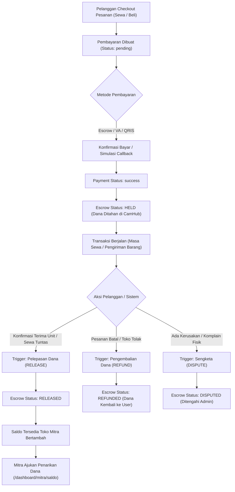

# 10. IMPLEMENTATION PLAN — TAHAP 10: INTEGRASI PEMBAYARAN & ESCROW GATEWAY

> **NAMA PROYEK:** CamHub – Camera Marketplace Platform  
> **TIM PENGEMBANG (KELOMPOK 1):**  
> 1. **Yogi Ario Pratama** — *Project Owner & Lead Developer*  
> 2. **Muhammad Regieyanto** — *Backend & System Architect*  
> 3. **Ivan Farrel Nanda Kristanto** — *Core Routing & Security Engineer*  
> 4. **Krisna Mukti** — *Quality Assurance & Presentation Coordinator*  
>  
> **PRINSIP OPERASIONAL DASAR & INTEGRITAS REKAYASA:**  
> - **No Plan, No Code. No Approval, No Code.** Rencana harus disepakati sebelum kode ditulis.  
> - **No Evidence, No Completion.** Pekerjaan tidak boleh dinyatakan selesai tanpa bukti verifikasi yang sesuai (pengujian otomatis, verifikasi visual browser, audit database).  
> - **No Superfluous AI Boilerplate.** Jangan menambahkan elemen formalitas tambahan, blok komentar yang tidak perlu, atau boilerplate artifisial yang tidak ada pada panduan penugasan agar tetap natural, otentik, dan tidak tampak seperti hasil generasi instan AI.  
>  
> **TARGET MILESTONE:** Tahap 10 — Integrasi Pembayaran & Escrow Gateway  
> **BRANCH RESMI GIT:** `tahap/10-pembayaran-escrow` (dibuat dari `develop`)  
> **ACUAN PROTOTYPE RESMI:**  
> - [`template/CamHub — Interactive UI UX Prototype/CamHub — Dashboard Mitra Lapak.png`](../../template/CamHub%20%E2%80%94%20Interactive%20UI%20UX%20Prototype/CamHub%20%E2%80%94%20Dashboard%20Mitra%20Lapak.png) (Acuan Tampilan Saldo & Pencairan Dana Mitra serta Perbaikan Bersih Menu Sidebar)  
> - [`template/CamHub — Interactive UI UX Prototype/CamHub — Booking & Checkout.png`](../../template/CamHub%20%E2%80%94%20Interactive%20UI%20UX%20Prototype/CamHub%20%E2%80%94%20Booking%20&%20Checkout.png) (Status Rekening Bersama Escrow pada Checkout & Bukti Pembayaran)  
> - [`template/CamHub — Interactive UI UX Prototype/CamHub — Dashboard Pelanggan.png`](../../template/CamHub%20%E2%80%94%20Interactive%20UI%20UX%20Prototype/CamHub%20%E2%80%94%20Dashboard%20Pelanggan.png) (Pelepasan Dana Escrow saat Pelanggan Konfirmasi Terima Barang / Selesai Sewa)  
>  
> **TABEL TERKAIT:** `payments`, `payment_transactions`, `escrow_transactions`, `partner_stores`, `partners`, `rental_bookings`, `sales_orders`, `users`, `audit_logs`

---

## 1. Perbaikan Prioritas Cacat Visual Dashboard Mitra

Sebelum memulai integrasi alur finansial Tahap 10, dilakukan pembersihan menyeluruh pada berkas antarmuka [`resources/views/partner/dashboard.php`](file:///c:/laragon/www/camhub/resources/views/partner/dashboard.php):

```
[KONDISI SEKARANG (BERMASALAH)]                  [TARGET PERBAIKAN BERSIH TAHAP 10]
----------------------------------------------   -------------------------------------------------
1. Teks komentar HTML bocor ke atas layar:       1. Seluruh sisa penutup '-->' dihapus bersih atau
   - SIDEBAR NAVY GELAP (PERSIS MOCKUP) -->         dikembalikan dengan tag pembuka '<!--' yang benar.
   - KONTEN UTAMA DASHBOARD MITRA -->            2. Halaman tampil bersih tanpa ada teks liar.
   - 3 KARTU METRIK UTAMA (PERSIS MOCKUP) -->    3. Menu 'Kelola Titip Jual' di sidebar hanya tampil
   - SEKSI PRODUK SAYA (PERSIS MOCKUP) -->          1 kali secara rapi dan presisi.
2. Menu 'Kelola Titip Jual' muncul 2 KALI dobel  4. Tombol Logout tetap terpasang mencolok & aman.
```

---

## 2. Latar Belakang & Nilai Bisnis Tahap 10

Pada Tahap 07, 08, dan 09, alur transaksi sewa (*rental*), jual beli (*sales*), dan titip jual (*consignment*) telah berjalan di mana dana transaksi ditampung pada status awal `held` di tabel `escrow_transactions`.

**Tahap 10 menutup siklus finansial menyeluruh CamHub dengan membangun:**
1. **Siklus Hidup Rekening Bersama Escrow Dinamis:**
   - `held`: Dana ditahan secara aman saat transaksi diverifikasi.
   - `released`: Pelepasan dana otomatis ke dompet Toko Mitra saat penyewa menyelesaikan sewa atau pembeli mengonfirmasi kamera diterima sesuai deskripsi fisik.
   - `refunded`: Pengembalian dana penuh ke saldo/rekening pelanggan jika pesanan dibatalkan atau unit fisik gagal verifikasi saat serah terima.
   - `disputed`: Penahanan sengketa jika terjadi komplain kerusakan unit, keterlambatan, atau klaim garansi.
2. **Simulasi Gateway Pembayaran Otomatis:**
   - Mendukung metode pembayaran: `escrow` (rekening bersama CamHub), `bank_transfer` (Virtual Account simulasi), dan `ewallet` (QRIS).
   - Endpoint webhook/callback simulasi untuk mengubah status pembayaran dari `pending` ke `success` secara instan.
3. **Modul Dompet & Pencairan Saldo Mitra (*Partner Wallet & Withdrawal*):**
   - Halaman `/dashboard/mitra/saldo` dengan visualisasi:
     - **Saldo Tersedia (*Available Balance*):** Dana hasil sewa & penjualan yang telah dirilis dari escrow dan siap dicairkan ke rekening bank.
     - **Saldo Tertahan (*Escrow Balance*):** Dana transaksi yang masih berjalan dan belum selesai.
     - **Formulir Pengajuan Penarikan Dana (*Withdrawal Request*):** Mitra menginput nominal dan nama bank tujuan.

---

## 3. Diagram Alur Siklus Escrow & Pembayaran (Mermaid Flowchart)



---

## 4. Rencana Arsitektur & Spesifikasi Berkas

### A. Perbaikan Berkas Tampilan Mitra
- **`resources/views/partner/dashboard.php`:**
  - Menghapus 4 teks komentar bocor (`-->`).
  - Menghapus blok duplikasi menu `Kelola Titip Jual` (hanya tersisa 1 elemen nav item).
  - Merapikan tag HTML penutup `</a></li>`.

### B. Lapisan Repositori Data (`app/Repositories/`)
1. **`App\Repositories\EscrowRepository.php` (Baru):**
   - `getEscrowByBookingId(int $bookingId): ?array`
   - `getEscrowByOrderId(int $orderId): ?array`
   - `releaseEscrow(int $escrowId): bool` (Ubah status ke `released`, catat `released_at = NOW()`).
   - `refundEscrow(int $escrowId, string $notes): bool` (Ubah status ke `refunded`).
   - `disputeEscrow(int $escrowId, string $reason): bool` (Ubah status ke `disputed`).
   - `getPartnerBalanceMetrics(int $partnerId): array` (Kalkulasi saldo cair vs saldo tertahan).
2. **`App\Repositories\PaymentRepository.php` (Pembaruan):**
   - `markAsPaid(int $paymentId, string $method, ?string $gatewayTrxId = null): bool`
   - `getPaymentByReference(string $orderType, int $referenceId): ?array`

### C. Lapisan Layanan Bisnis (`app/Services/`)
1. **`App\Services\EscrowService.php` (Baru):**
   - Mengorkestrasi pelepasan dana saat pesanan tuntas.
   - Memastikan hak akses pelanggan yang mengonfirmasi adalah pemilik pesanan yang sah.
   - Menghitung pembagian komisi platform vs pendapatan bersih mitra.
2. **`App\Services\PaymentService.php` (Pembaruan):**
   - Memproses simulasi verifikasi pembayaran instan tanpa payment gateway eksternal berbayar.

### D. Lapisan Pengontrol (`app/Controllers/`)
1. **`App\Controllers\EscrowController.php` (Baru):**
   - `confirmRentalComplete(int $bookingId)`: Pelanggan menyelesaikan sewa & melepas escrow.
   - `confirmSaleReceived(int $orderId)`: Pembeli konfirmasi terima kamera & melepas escrow.
   - `requestDispute(int $id)`: Pengajuan komplain/sengketa transaksi.
2. **`App\Controllers\PartnerWalletController.php` (Baru):**
   - `wallet()`: Menampilkan antarmuka saldo & riwayat escrow mitra di `/dashboard/mitra/saldo`.
   - `requestWithdrawal()`: Memproses formulir pencairan dana ke rekening bank mitra.

### E. Lapisan Tampilan Antarmuka (Views)
1. **`resources/views/partner/wallet.php` (Baru / Refactor Total):**
   - Tampilan Saldo Tersedia, Saldo Tertahan Escrow, Riwayat Dana Masuk, dan Form Penarikan Dana ke Bank.
2. **Pembaruan `resources/views/customer/orders.php` & `sales/success.php`:**
   - Tombol **"Konfirmasi Terima Barang & Lepas Escrow"** pada kartu pesanan yang sedang berjalan.
   - Label status badge escrow yang transparan (*Dana Ditahan di Rekber*, *Dana Telah Diteruskan ke Mitra*).

---

## 5. Rencana Pengujian Otomatis (DoD - Definition of Done)

Pengujian akan dijalankan melalui berkas uji mandiri [`tests/test_escrow_payment.php`](file:///c:/laragon/www/camhub/tests/test_escrow_payment.php) dengan 10 skenario:

| No | Kode Pengujian | Skenario Uji | Kriteria Sukses |
|:---:|:---|:---|:---|
| 1 | `TEST-ESC-01` | **Pembersihan Cacat Visual Dashboard Mitra** | Tidak ditemukan teks komentar `-->` bocor dan menu Titip Jual tepat berjumlah 1. |
| 2 | `TEST-ESC-02` | **Integritas Record Escrow pada Booking Sewa** | Escrow otomatis berstatus `held` dengan nominal sewa yang terkunci di database. |
| 3 | `TEST-ESC-03` | **Integritas Record Escrow pada Order Jual Beli** | Escrow menahan dana beli `#BUY-XXXXX` dengan isolasi `sales_order_id`. |
| 4 | `TEST-ESC-04` | **Simulasi Callback Pembayaran Sukses** | Endpoint pembayaran mengubah status pembayaran menjadi `success` dan mencatat `paid_at`. |
| 5 | `TEST-ESC-05` | **Konfirmasi Pelanggan & Pelepasan Dana (Release)** | Pelanggan klik terima unit -> status escrow berubah `released` & tanggal rilis tercatat. |
| 6 | `TEST-ESC-06` | **Kalkulasi Saldo Tersedia Toko Mitra** | Saldo cair mitra bertambah secara akurat sesuai nilai transaksi yang di-release. |
| 7 | `TEST-ESC-07` | **Mekanisme Pembatalan & Pengembalian Dana (Refund)** | Transaksi dibatalkan -> status escrow berubah `refunded` dan dana tidak masuk ke saldo mitra. |
| 8 | `TEST-ESC-08` | **Mekanisme Pengajuan Sengketa (Dispute)** | Pelanggan komplain kerusakan -> status escrow terkunci `disputed` dan pencairan ditangguhkan. |
| 9 | `TEST-ESC-09` | **Validasi Formulir Penarikan Saldo Mitra** | Penarikan dana gagal jika melebihi saldo tersedia atau nomor rekening tidak diisi. |
| 10 | `TEST-ESC-10` | **Perekaman Audit Trail Finansial & Transaksi ACID** | Setiap mutasi status escrow tercatat aman dalam `audit_logs` dan dilindungi rollback. |

**Target Akumulatif Pengujian:**
- Total tes saat ini: **101 / 101 PASS**
- Tambahan tes Tahap 10: **10 / 10 PASS**
- **Target Akumulatif Platform: 111 / 111 PASS (100% SUKSES, 0 GAGAL / 0 ERROR)**

---

## 6. Tata Kelola Git & Pembagian Peran Anggota Tim (Kelompok 1)

1. **Yogi Ario Pratama (Project Owner & Lead Developer):**
   - Mengawasi pembersihan cacat visual komentar HTML di dashboard mitra.
   - Menguji interaktivitas tombol "Konfirmasi Terima Unit & Lepas Escrow" di browser nyata.
2. **Muhammad Regieyanto (Backend & System Architect):**
   - Merancang logika transaksi pelepasan dana (`releaseEscrow`), pengembalian (`refund`), dan perhitungan saldo mitra di `EscrowService`.
3. **Ivan Farrel Nanda Kristanto (Core Routing & Security Engineer):**
   - Mengamankan rute konfirmasi penerimaan dari serangan Anti-IDOR (hanya pembeli sah yang dapat melepas dana).
4. **Krisna Mukti (Quality Assurance & Presentation Coordinator):**
   - Mengeksekusi rangkaian uji `test_escrow_payment.php`, menyusun buku panduan Tahap 10, dan memverifikasi kelengkapan dokumen sidang.

---

> [!NOTE]
> **Instruksi Baku Operasional:**  
> - **No Plan, No Code. No Approval, No Code.**  
> - **No Evidence, No Completion.** Pekerjaan tidak boleh dinyatakan selesai tanpa bukti verifikasi yang sesuai.  
>  
> **Prinsip operasional tambahan yang menjadi dasar kerangka ini:**  
> - **No Superfluous AI Boilerplate:** Jangan menambahkan elemen formalitas tambahan, blok komentar yang tidak perlu, atau boilerplate artifisial yang tidak ada pada panduan penugasan agar tetap natural, otentik, dan tidak tampak seperti hasil generasi instan AI.  
>  
> Silakan tinjau dan berikan komentar pada dokumen rencana ini, atau klik tombol **Proceed** untuk menyetujui dan memulai pengerjaan Tahap 10.

