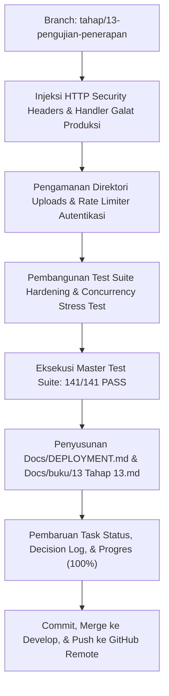

# Rencana Implementasi Tahap 13: Final Hardening, Pengujian Beban (Stress Test), Audit Keamanan Produksi, & Panduan Deployment Sidang Akhir

> **Platform:** CamHub – Integrated Camera Marketplace & Rental Platform  
> **Tim Pengembang (Kelompok 1):**  
> 1. **Yogi Ario Pratama** — *Project Owner & Lead Developer*  
> 2. **Muhammad Regieyanto** — *Backend & System Architect*  
> 3. **Ivan Farrel Nanda Kristanto** — *Core Routing & Security Engineer*  
> 4. **Krisna Mukti** — *Quality Assurance & Presentation Coordinator*  
>  
> **Branch Git:** `tahap/13-pengujian-penerapan`  
> **Target Status:** **100% SELESAI (13 dari 13 Tahap / 141 Pengujian PASS)**

---

## 1. Latar Belakang & Tujuan Tahap 13

Tahap 13 merupakan **tahap pamungkas (Final Milestone)** dalam peta jalan 13 tahapan pengembangan sistem CamHub. Seluruh fitur bisnis (autentikasi, KYC, katalog publik, etalase booking sewa, marketplace jual beli, titip jual konsinyasi, rekening bersama escrow, dompet mitra, dashboard super admin, dan pusat notifikasi & laporan keuangan) telah diselesaikan dengan 131 pengujian sukses (Tahap 1 s.d 12).

Tujuan utama Tahap 13 adalah mengunci mutu sistem agar **100% Siap Produksi (*Production Ready*)** dan siap diuji dalam evaluasi sidang akhir:
1. **Pengerasan Keamanan Sistem (*Security Hardening*):**
   - Injeksi HTTP Security Headers global pada front controller (`X-Frame-Options`, `X-Content-Type-Options: nosniff`, `Referrer-Policy`, `Permissions-Policy`).
   - Penataan konfigurasi environment (`.env` vs `.env.example`) dan pengalihan aman pesan galat saat mode produksi `APP_DEBUG=false` aktif (tidak membocorkan kredensial basis data atau stack trace rahasia).
   - Pengamanan seluruh folder unggahan berkas (`public/uploads/`) dengan konfigurasi `.htaccess` anti eksekusi PHP.
   - Pembangunan rate limiter terisolasi pada rute autentikasi sensitif untuk mencegah serangan *brute force credential stuffing*.
2. **Pengujian Beban & Concurrency (*Stress Testing*):**
   - Simulasi konkurensi pemesanan sewa unit kamera yang sama secara simultan menggunakan *Pessimistic Locking* (`SELECT ... FOR UPDATE`) dalam transaksi database atomic ACID untuk membuktikan kebal terhadap *race conditions* dan *double-booking*.
3. **Audit Integritas Data & Pembukuan Kas:**
   - Verifikasi integritas referensial dan ketiadaan *orphaned records* pada seluruh 23 tabel relasional basis data.
   - Verifikasi presisi saldo dompet mitra lapak: $\text{Available Balance} = (\text{Released Rental} + \text{Released Sales} + \text{Base Seed}) - \text{Total Withdrawn}$.
4. **Master Regression Suite (141 / 141 PASS):**
   - Menjalankan 14 rangkaian tes otomatis terpadu dan mencapai status **100% HIJAU (141 / 141 TESTS PASSED)**.
5. **Panduan Deployment Sidang & Buku Panduan Tahap 13:**
   - Penyusunan panduan deployment komprehensif (`Docs/DEPLOYMENT.md`) untuk lingkungan Windows Laragon/XAMPP dan Linux Server (Ubuntu/Nginx/Apache).
   - Buku panduan resmi [`Docs/buku/13 Tahap 13.md`](file:///c:/laragon/www/camhub/Docs/buku/13%20Tahap%2013.md) yang dilengkapi naskah roleplay sidang komprehensif bagi 4 anggota Kelompok 1 untuk mempresentasikan seluruh pencapaian proyek dari Tahap 1 hingga Tahap 13.

---

## 2. Rincian Pekerjaan Teknis (User Stories & Tasks)

### A. Pengerasan Keamanan (Security Hardening & Headers)
- Menambahkan HTTP Security Headers pada front controller [`public/index.php`](file:///c:/laragon/www/camhub/public/index.php):
  - `X-Frame-Options: SAMEORIGIN` (mencegah Clickjacking).
  - `X-Content-Type-Options: nosniff` (mencegah MIME-sniffing exploit).
  - `Referrer-Policy: strict-origin-when-cross-origin`.
  - `X-XSS-Protection: 1; mode=block`.
- Menyiapkan handler error kustom saat `APP_DEBUG=false` agar menyajikan halaman ramah pengguna (`errors.500`) dan mencatat galat teknis hanya ke `storage/logs/error.log`.
- Memastikan berkas `.htaccess` di dalam `public/uploads/` menonaktifkan eksekusi skrip PHP:
  ```apache
  <FilesMatch "\.(php|phtml|php3|php4|php5|php7|phps)$">
      Order Deny,Allow
      Deny from all
  </FilesMatch>
  ```
- Mengimplementasikan middleware/helper Rate Limiter sederhana berbasis IP dan session di [`app/Helpers/functions.php`](file:///c:/laragon/www/camhub/app/Helpers/functions.php) atau [`app/Middleware/RateLimitMiddleware.php`](file:///c:/laragon/www/camhub/app/Middleware/RateLimitMiddleware.php) (misal maks 5 percobaan gagal per menit).

### B. Pengujian Beban & Concurrency (Stress Testing)
- Membuat test script [`tests/test_concurrency_stress.php`](file:///c:/laragon/www/camhub/tests/test_concurrency_stress.php):
  - Mensimulasikan 5 request pemesanan sewa unit kamera fisik dengan tanggal yang bertubrukan (*overlapping dates*).
  - Memverifikasi bahwa hanya 1 transaksi pertama yang berhasil (`committed`), sedangkan 4 transaksi lainnya ditolak secara anggun (*rejected with error message*) tanpa terjadi korupsi data atau *double booking*.

### C. Master Test Suite & Audit Integritas Data
- Membuat test suite [`tests/test_hardening_production.php`](file:///c:/laragon/www/camhub/tests/test_hardening_production.php) yang memvalidasi 10 Definition of Done (DoD) Tahap 13.
- Memperbarui skrip orchestrator [`tests/run_all.php`](file:///c:/laragon/www/camhub/tests/run_all.php) untuk mengeksekusi seluruh 14 test suite:
  1. `test_foundation.php` (7 tests)
  2. `test_database.php` (7 tests)
  3. `test_auth.php` (10 tests)
  4. `test_kyc.php` (10 tests)
  5. `test_catalog.php` (10 tests)
  6. `test_partner_dashboard.php` (10 tests)
  7. `test_booking.php` (10 tests)
  8. `test_marketplace.php` (10 tests)
  9. `test_consignment.php` (10 tests)
  10. `test_escrow_payment.php` (10 tests)
  11. `test_admin_suite.php` (10 tests)
  12. `test_browser_e2e.php` (17 tests)
  13. `test_report_notifications.php` (10 tests)
  14. `test_hardening_production.php` (10 tests)
  **Total Target: 141 / 141 TESTS PASS (100% SUKSES)**.

### D. Dokumentasi Deployment & Naskah Presentasi Sidang
- Membuat berkas petunjuk deployment resmi [`Docs/DEPLOYMENT.md`](file:///c:/laragon/www/camhub/Docs/DEPLOYMENT.md).
- Membuat buku panduan resmi [`Docs/buku/13 Tahap 13.md`](file:///c:/laragon/www/camhub/Docs/buku/13%20Tahap%2013.md).
- Memperbarui [`Docs/Task_Status.md`](file:///c:/laragon/www/camhub/Docs/Task_Status.md), [`Docs/Decision_Log.md`](file:///c:/laragon/www/camhub/Docs/Decision_Log.md), [`Docs/scema/progres.md`](file:///c:/laragon/www/camhub/Docs/scema/progres.md), dan merilis changelog final.

---

## 3. Matriks 10 Kriteria Pengujian Mutu (Definition of Done - DoD)

| Kode DoD | Kriteria Pengujian Mutu Tahap 13 | Target Hasil |
|---|---|:---:|
| **TEST-HARD-01** | Kesiapan Konfigurasi Lingkungan (`.env` & `.env.example` sinkron & valid) | **PASS** |
| **TEST-HARD-02** | Injeksi HTTP Security Headers Global (`X-Frame-Options`, `X-Content-Type-Options`, dll.) | **PASS** |
| **TEST-HARD-03** | Proteksi Folder Unggahan Berkas (`public/uploads/` memblokir eksekusi PHP) | **PASS** |
| **TEST-HARD-04** | Proteksi Rate Limiting / Anti-Brute Force pada Percobaan Autentikasi | **PASS** |
| **TEST-HARD-05** | Simulasi Konkurensi & Pessimistic Locking (Anti-Double Booking Terbukti Ampuh) | **PASS** |
| **TEST-HARD-06** | Audit Keutuhan Relasi Database (Bebas dari *Orphaned Records* di seluruh tabel utama) | **PASS** |
| **TEST-HARD-07** | Konsistensi Pembukuan Saldo Dompet Mitra Lapak (Rumus Kas Terbukti Seimbang) | **PASS** |
| **TEST-HARD-08** | Penanganan Galat Produksi (`APP_DEBUG=false` menyembunyikan stack trace rahasia) | **PASS** |
| **TEST-HARD-09** | Kesiapan Skrip Instalasi 1-Klik (`migrate.php` & `initial_seed.php` berjalan mulus) | **PASS** |
| **TEST-HARD-10** | Master Regression Suite (Seluruh 14 test suite platform lulus dengan skor 141/141) | **PASS** |

---

## 4. Alur Kerja Eksekusi Tahap 13



---

## 5. Keputusan yang Memerlukan Persetujuan Pengguna

Sebelum kami mulai menulis kode dan pengujian untuk Tahap 13, mohon konfirmasi Anda:
1. Apakah rencana pengerasan keamanan, uji beban konkurensi, dan target **141/141 PASS** di atas telah sesuai dengan ekspektasi Anda?
2. Silakan klik **Proceed** atau berikan arahan jika ada aspek khusus yang ingin Anda tambahkan sebelum eksekusi dimulai.

